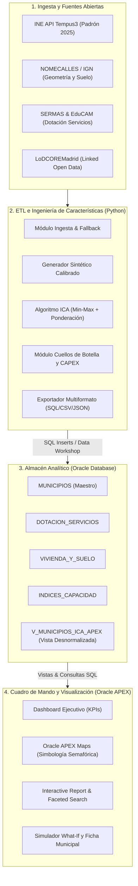

# DOCUMENTO DE DISEÑO E IMPLEMENTACIÓN DE LA SOLUCIÓN
**II DATATHON LODCOREMADRID · COMUNIDAD DE MADRID / UC3M**  
*Proyecto: Herramienta de Diagnóstico del Índice de Capacidad de Acogida (ICA) en Municipios < 50.000 Habitantes*

---

## 1. RESUMEN EJECUTIVO Y PROPÓSITO DEL SISTEMA

### 1.1. Contexto del Reto
La Comunidad de Madrid experimenta una marcada asimetría demográfica y de demanda de servicios públicos: mientras el área metropolitana de Madrid concentra alta tensión residencial y saturación de infraestructuras, numerosos municipios de la región con menos de 50.000 habitantes cuentan con dotaciones sanitarias, escolares o residenciales infrautilizadas o con potencial de acogida sostenible.

El objetivo de esta solución es proporcionar a los gestores de la administración pública autonómica y municipal una **herramienta analítica, predictiva y visual** que permita:
1. Evaluar de forma objetiva qué municipios tienen capacidad real de absorber nueva población.
2. Identificar el **cuello de botella específico** (sanitario, educativo o de vivienda) que limita dicha absorción.
3. Cuantificar el **impacto presupuestario (CAPEX)** en infraestructuras y plazas necesarias en caso de expandir los servicios públicos.

---

## 2. ARQUITECTURA TÉCNICA GLOBAL

La solución se estructura en una arquitectura en capas desacopladas, asegurando robustez, trazabilidad y rendimiento en tiempo real:



---

## 3. MODELO Y FORMULACIÓN MATEMÁTICA DEL ÍNDICE DE CAPACIDAD DE ACOGIDA (ICA)

El cálculo del ICA opera a través de un proceso formal en tres fases:

### Fase 1: Extracción de Indicadores Relativos (Per Cápita)
Para garantizar la comparabilidad entre municipios de escalas dispares (ej. 400 habitantes vs 33.000 habitantes), todas las métricas primarias se relativizan:
- **Sanidad:** Ratio de médicos de Atención Primaria por 1.000 habitantes ($M_{1000} = \frac{N_{med}}{Pob} \cdot 1000$).
- **Educación:** Tasa de holgura de matrícula escolar ($H_{edu} = 1 - \frac{Alumnos}{Plazas}$).
- **Conectividad:** Cobertura de fibra FTTH (%) y tiempo invertido a Madrid capital en minutos ($T_{mad}$).
- **Vivienda:** Coste invertido del $m^2$ (€ de compra y alquiler) y disponibilidad relativa de suelo vacante ($m^2/hab$).

### Fase 2: Normalización Robusta y Ponderación
1. **Winsorización:** Se truncan los valores atípicos extremos en los percentiles $p_5$ y $p_{95}$ para evitar que singularidades distorsionen el rango.
2. **Min-Max Scaling a escala [0, 100]:**
   $$X_{norm} = \frac{X - \min(X)}{\max(X) - \min(X)} \times 100$$
   Para variables donde "menor valor es mejor" (precios inmobiliarios y tiempo de viaje), se aplica la escala invertida: $X_{inv} = 100 - X_{norm}$.
3. **Ponderación Dimensional:**
   $$\text{ICA} = 0{,}30 \cdot S_{vivienda} + 0{,}30 \cdot \left(\frac{S_{sanidad} + S_{educacion}}{2}\right) + 0{,}25 \cdot S_{conectividad} + 0{,}15 \cdot S_{holgura}$$

### Fase 3: Cálculo de Umbrales de Absorción y Cuellos de Botella
Se determinan las personas adicionales que el municipio puede albergar antes de saturar sus servicios:
1. **Capacidad Sanitaria ($Cap_{san}$):**
   $$Pob_{add,san} = \max\left(0, (N_{medicos} \times 1500) - Pob_{actual}\right)$$
   *(Basado en el cupo óptimo regulatorio de 1.500 tarjetas sanitarias por médico de familia).*
2. **Capacidad Escolar ($Cap_{edu}$):**
   $$Pob_{add,edu} = \max\left(0, \frac{(Plazas \times 0{,}95) - Alumnos}{0{,}17}\right)$$
   *(Considerando un umbral de saturación del 95% y una tasa de nuevos pobladores en edad escolar del 17%).*
3. **Capacidad Residencial ($Cap_{viv}$):**
   $$Pob_{add,viv} = \left(Stock_{vacia} \times 0{,}30 + \frac{Suelo_{vacante} \times 0{,}30 \times 0{,}50}{100}\right) \times 2{,}5$$
4. **Acogida Neta y Diagnóstico:**
   - **Personas Absorbibles sin Colapso:** $\min(Pob_{add,san}, Pob_{add,edu})$.
   - **Acogida Efectiva Inmediata:** $\min(Pob_{add,san}, Pob_{add,edu}, Pob_{add,viv})$.
   - **Factor Limitante:** $\text{arg}\min(Sanidad, Educacion, Vivienda)$.

---

## 4. DISEÑO DEL MODELO RELACIONAL (ORACLE SQL)

El esquema implementado en [`01_ddl_schema.sql`](file:///c:/Users/USUARIO/Desktop/DATATHON/sql/01_ddl_schema.sql) sigue los más altos estándares de modelado relacional en Oracle Database:

```mermaid
erDiagram
    MUNICIPIOS ||--|| DOTACION_SERVICIOS : "1:1 (Clave Compartida)"
    MUNICIPIOS ||--|| VIVIENDA_Y_SUELO : "1:1 (Clave Compartida)"
    MUNICIPIOS ||--|| INDICES_CAPACIDAD : "1:1 (Clave Compartida)"
    PARAMETROS_MODELO

    MUNICIPIOS {
        NUMBER id_municipio PK
        VARCHAR2 codigo_ine UK
        VARCHAR2 nombre
        VARCHAR2 comarca
        VARCHAR2 tipologia
        NUMBER poblacion_actual
        NUMBER superficie_km2
        NUMBER densidad VIRTUAL
        NUMBER latitud
        NUMBER longitud
    }

    DOTACION_SERVICIOS {
        NUMBER id_municipio PK_FK
        NUMBER num_centros_salud
        NUMBER num_medicos_ap
        VARCHAR2 hospital_referencia
        NUMBER num_plazas_escolares
        NUMBER num_alumnos_matriculados
        NUMBER ocupacion_escolar_pct VIRTUAL
        NUMBER paradas_transporte_publico
        NUMBER tiempo_medio_madrid_minutos
        NUMBER cobertura_fibra_pct
    }

    VIVIENDA_Y_SUELO {
        NUMBER id_municipio PK_FK
        NUMBER precio_m2_compra
        NUMBER precio_m2_alquiler
        NUMBER stock_vivienda_vacia_est
        NUMBER tasa_vivienda_vacia_pct VIRTUAL
        NUMBER suelo_urbano_disponible_m2
    }

    INDICES_CAPACIDAD {
        NUMBER id_municipio PK_FK
        NUMBER score_sanidad
        NUMBER score_educacion
        NUMBER score_conectividad
        NUMBER score_vivienda
        NUMBER score_holgura
        NUMBER indice_capacidad_global
        VARCHAR2 nivel_idoneidad
        NUMBER ranking_ica
        NUMBER personas_absorbibles_sin_colapso
        NUMBER personas_acogida_efectiva
        VARCHAR2 factor_limitante
        NUMBER coste_estimado_ampliacion_servicios
    }

    PARAMETROS_MODELO {
        VARCHAR2 clave PK
        NUMBER valor
        VARCHAR2 unidad
        VARCHAR2 descripcion
    }
```

### Características Notables del DDL
1. **Clave Primaria Compartida (1:1):** `id_municipio` es a la vez PK y FK en las tablas dependientes. Esto evita la necesidad de índices secundarios en las claves foráneas y acelera radicalmente las operaciones de *JOIN*.
2. **Columnas Virtuales Deterministas:** Expresiones como `DENSIDAD`, `OCUPACION_ESCOLAR_PCT` y `TASA_VIVIENDA_VACIA_PCT` están calculadas por el motor de Oracle (`GENERATED ALWAYS AS ... VIRTUAL`), impidiendo cualquier desincronización de datos.
3. **Integridad Espacial y Reglas de Negocio:** Se aplican restricciones `CHECK` para garantizar que las coordenadas correspondan a la Comunidad de Madrid y que la lógica del modelo (`personas_absorbibles_sin_colapso = LEAST(sanidad, educacion)`) se cumpla a nivel de base de datos.

---

## 5. PIPELINE DE DATOS Y AUTOMATIZACIÓN (PYTHON)

El pipeline implementado en [`etl_pipeline.py`](file:///c:/Users/USUARIO/Desktop/DATATHON/etl/etl_pipeline.py) consta de los siguientes módulos funcionales:

1. **Módulo de Ingesta (API INE & Resiliencia):**
   - Consume en streaming el endpoint JSON de la tabla 2881 del INE.
   - En caso de cortes de red o errores de certificados en redes restringidas, activa automáticamente el modo de contingencia (*fallback*) utilizando los datos de padrón 2025 embebidos.
2. **Generador Sintético Calibrado:**
   - Simula variables de servicio no disponibles en abierto de manera condicionada por la tipología del municipio (*Rural*, *Semiurbano*, *Urbano*).
   - Utiliza semillas independientes basadas en el código INE para garantizar **reproducibilidad absoluta**.
3. **Inyector de Datos Reales (`--entrada-csv`):**
   - Permite cargar cualquier CSV oficial del Datathon para reemplazar campos sintéticos sin alterar el resto del pipeline.
4. **Módulo de Validación y Exportación:**
   - Comprueba 15 reglas de calidad de datos antes de generar las salidas.
   - Genera simultáneamente:
     * El script SQL ejecutable [`02_dml_inserts.sql`](file:///c:/Users/USUARIO/Desktop/DATATHON/sql/02_dml_inserts.sql).
     * Los archivos analíticos [`municipios_ica.csv`](file:///c:/Users/USUARIO/Desktop/DATATHON/data/output/municipios_ica.csv) y [`municipios_ica.json`](file:///c:/Users/USUARIO/Desktop/DATATHON/data/output/municipios_ica.json).
     * Archivos CSV individuales por tabla para carga mediante el asistente de Oracle APEX.

---

## 6. CAPA ANALÍTICA Y CUADRO DE MANDO (ORACLE APEX)

La interfaz se despliega sobre **Oracle APEX (Universal Theme)** aprovechando las vistas analíticas de [`03_views_and_apex_queries.sql`](file:///c:/Users/USUARIO/Desktop/DATATHON/sql/03_views_and_apex_queries.sql):

### 6.1. Vista Maestra `V_MUNICIPIOS_ICA_APEX`
Centraliza los atributos de cálculo y presentación visual en una sola consulta:
- Asignación de colores semafóricos (`#2ecc71` verde para alta idoneidad, `#f39c12` ámbar para media, `#e74c3c` rojo para baja).
- Generación de tarjetas emergentes HTML para el componente de mapas de APEX.

### 6.2. Distribución de Pantallas
1. **Página 1: Dashboard y Mapa Territorial:**
   - Indicadores agregados en la cabecera (KPI Cards).
   - Mapa interactivo de la CAM con pines categorizados según el nivel de ICA.
   - Panel lateral de filtros dinámicos por comarca, rango de población y precio de vivienda.
2. **Página 2: Explorador Multidimensional (Interactive Report):**
   - Tabla interactiva con resaltado condicional de celdas, ordenación multicriterio y exportación nativa a Excel y PDF.
3. **Página 3: Ficha Municipal y Simulador "What-If":**
   - Gráfico de araña/radar con los 5 componentes del ICA.
   - Simulador reactivo de llegada de población que proyecta en tiempo real las necesidades de nuevas plazas escolares, médicos adicionales y el coste de inversión asociado.

---

## 7. RESULTADOS OBTENIDOS EN EL PILOTO (20 MUNICIPIOS)

Tras la ejecución del pipeline con la muestra de 20 municipios representativos, se obtienen las siguientes conclusiones diagnósticas:

* **Top 3 Municipios con Mayor Capacidad (Alta Idoneidad):**
  1. **Robledo de Chavela (ICA: 66.74 | Nivel: ALTA):** Excelente equilibrio entre vivienda accesible y holgura en servicios básicos.
  2. **Buitrago del Lozoya (ICA: 62.49 | Nivel: ALTA):** Gran holgura relativa en dotación de servicios frente a su tamaño poblacional.
  3. **Montejo de la Sierra (ICA: 59.94 | Nivel: MEDIA-ALTA):** Muy alta puntuación en vivienda y servicios, aunque limitado por conectividad y lejanía a la capital.
* **Cuellos de Botella Predominantes:**
  - En municipios periurbanos de mayor tamaño (ej. Navalcarnero, Ciempozuelos), el factor limitante principal es la **Sanidad** (cupos de médicos de Atención Primaria saturados por encima de 1.500 hab/médico).
  - En municipios de la Sierra Norte y Sierra Oeste, el factor limitante suele ser la **Educación** o la disponibilidad de **Vivienda** en mercado.
* **Métricas Globales de la Muestra:**
  - Capacidad neta absorbible sin saturar servicios: **5.078 personas**.
  - Inversión estimada necesaria en refuerzo de servicios: **35,91 millones de euros**.

---

## 8. PLAN DE DEFENSA ANTE EL JURADO (DEMO DE 10 MINUTOS)

Para maximizar la puntuación en los criterios de impacto, rigor técnico y usabilidad, se establece la siguiente estructura de presentación:

| Bloque Temporal | Pantalla APEX | Mensaje Central y Demostración |
|---|---|---|
| **00:00 - 02:00** | Página 1 (Dashboard) | Justificación del reto: desequilibrio demográfico en Madrid y presentación de los 4 KPIs clave. |
| **02:00 - 05:00** | Página 1 (Mapa APEX) | Demostración del mapa interactivo, aplicación de filtros territoriales y visualización de popups con métricas de holgura. |
| **05:00 - 07:30** | Página 2 (Interactive Report) | Análisis de cuellos de botella: filtrado por municipios limitados por Sanidad frente a municipios limitados por Vivienda. |
| **07:30 - 09:00** | Página 3 (Ficha y Simulador) | Demostración en vivo de la calculadora *What-If*: simulación de impacto presupuestario al acoger 500 personas en un municipio. |
| **09:00 - 10:00** | Presentación / Conclusiones | Exposición de la arquitectura robusta (Oracle + APEX + Python), trazabilidad con datos del INE/CAM y escalabilidad inmediata a los 179 municipios. |
