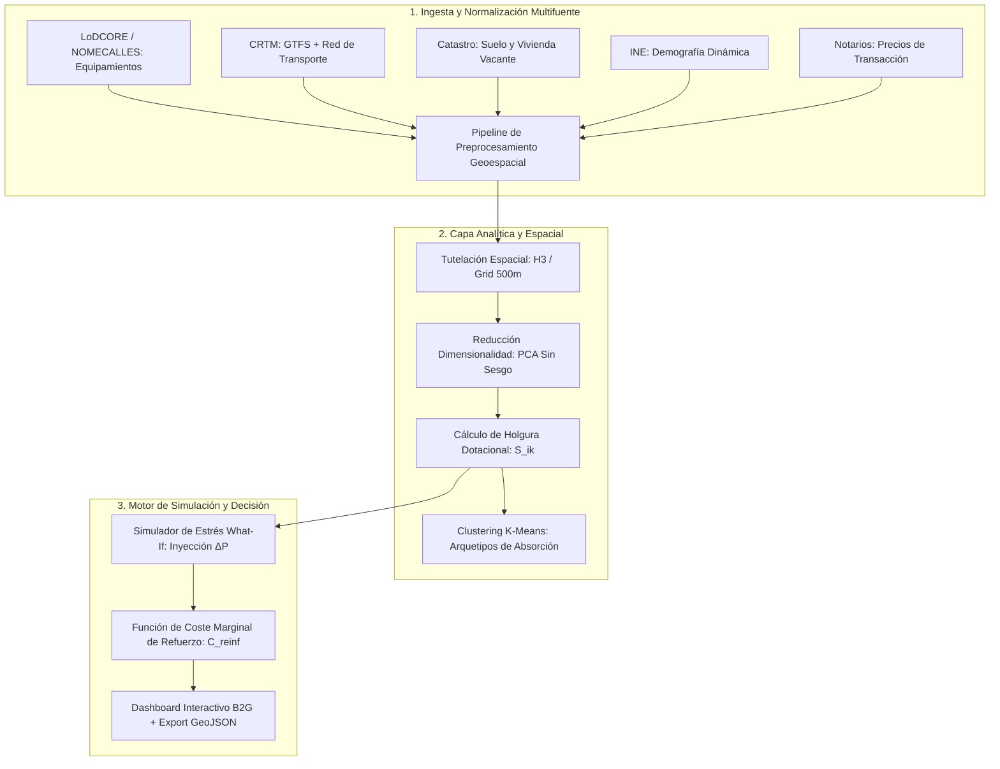

# ESPECIFICACIÓN TÉCNICA DE ARQUITECTURA Y MODELADO
## Sistema de Evaluación de Capacidad de Acogida, Holgura Dotacional y Simulación de Inversión Territorial
**Competición:** II Datathon LoDCOREMadrid 2026  
**Entorno de Ejecución:** Python 3.10+ / PostGIS u Oracle Autonomous Database / GeoPandas / Scikit-Learn / FastAPI o Streamlit

> ⚠️ **AVISO DE VIGENCIA (24 oct 2026):** especificación de ideas para una edición
> posterior. **No describe el MVP entregado**: el MVP usa Oracle APEX + FastAPI,
> 20 municipios, panel por municipio (sin H3, GTFS ni PostGIS) y solo INE + CKAN
> conectados. Estado real: `README.md` y `docs/validacion.md`. El checklist de
> defensa de 10 minutos de la sección 7 no es el guion oficial: el guion es de
> 15 minutos (`docs/guion_presentacion_15min.md`).

---

## 1. FORMULACIÓN MATEMÁTICA Y MODELADO ANALÍTICO

El objetivo es modelar un **Sistema de Decisión Espacial Multicriterio (MC-SDSS)** para la Administración Pública que cuantifique la holgura de los municipios de $< 50.000$ habitantes para absorber nueva población y calcule la función de coste marginal de refuerzo infraestructural.



### 1.1. Vector de Estado Municipal e Indicadores Dotacionales
Sea $M = \{m_1, m_2, \dots, m_N\}$ el conjunto de $N$ municipios de la Comunidad de Madrid con población $P_i < 50.000$.  
Para cada municipio $m_i$, se define un tensor de dotaciones $D_{ik}$ para $K$ dimensiones funcionales:
1. $k=1$: **Capacidad Sanitaria** (camas hospitalarias, cupos de médicos de familia en consultorios/centros de salud por $10^3$ hab).
2. $k=2$: **Capacidad Educativa** (ratio alumnos/aula en Infantil, Primaria y Secundaria vs. límite legal de ratio ratio máxima).
3. $k=3$: **Capacidad de Transporte Público** (frecuencia horaria ponderada, capacidad de plazas/hora en líneas regulares CRTM hacia nodos de empleo/Madrid central).
4. $k=4$: **Capacidad Habitacional y Suelo** (inmuebles vacantes catastrales, parcelas rústicas urbanizables no consolidadas).
5. $k=5$: **Capacidad de Saneamiento y Ciclo del Agua** (caudal de diseño de depuradoras EDAR vs. carga contaminante equivalente actual).

### 1.2. Métrica de Holgura Dotacional ($S_{ik}$) y Umbral de Saturación
Para cada municipio $i$ y dimensión $k$, definimos la **Holgura Dotacional Normalizada** $S_{ik} \in [-\infty, 1]$:

$$S_{ik} = \frac{C_{ik}^{max} - C_{ik}^{actual}}{C_{ik}^{max}} = 1 - \frac{P_i \cdot \rho_{ik}}{C_{ik}^{max}}$$

Donde:
* $C_{ik}^{max}$: Capacidad máxima nominal del servicio $k$ en el municipio $i$ antes de incurrir en déficit legal o de servicio.
* $\rho_{ik}$: Tasa de consumo per cápita del servicio $k$.
* Si $S_{ik} > 0$: El municipio dispone de **holgura** (capacidad ociosa absorbente).
* Si $S_{ik} \le 0$: El municipio se encuentra en **saturación o estrés dotacional**.

### 1.3. Población Máxima Absorbible sin Inversión de Capital ($\Delta P_i^{crit}$)
El cuello de botella de absorción inmediata del municipio $i$ viene dictado por el operador infimum sobre las dimensiones dotacionales esenciales:

$$\Delta P_i^{crit} = \min_{k \in K_{crit}} \left( \frac{C_{ik}^{max} - C_{ik}^{actual}}{\rho_{ik}} \right)$$

### 1.4. Función de Coste Marginal de Refuerzo Infraestructural ($C_{reinf}$)
Si la administración pública decide inyectar una población $\Delta P_i > \Delta P_i^{crit}$, el coste de capital (CapEx) y operación anual (OpEx) se modela como una función continua por tramos (step-function con costes fijos discretos de infraestructura):

$$C_{reinf}(m_i, \Delta P_i) = \sum_{k=1}^K \left\lceil \max\left(0, \frac{\Delta P_i - \Delta P_{ik}^{slack}}{U_k} \right) \right\rceil \cdot \beta_k + \Delta P_i \cdot \gamma_k$$

Donde:
* $\Delta P_{ik}^{slack}$: Población que agota la holgura de la dimensión $k$.
* $U_k$: Tamaño unitario del módulo infraestructural de ampliación (ej. unidad de $1$ aula para $25$ alumnos, unidad de consultorio para $1.500$ tarjetas sanitarias, $1$ expedición de autobús para $60$ plazas).
* $\beta_k$: Coste de inversión fija de habilitar una nueva unidad del servicio $k$.
* $\gamma_k$: Coste variable marginal operativo por habitante adicional.

### 1.5. Índice Sintético de Capacidad de Acogida ($I_{cap}$)
Para la priorización territorial, se calcula un índice agregado ponderado con normalización Min-Max:

$$I_{cap}(m_i) = \sum_{k=1}^K w_k \cdot \tilde{S}_{ik} + \lambda \cdot \text{Sim}(m_i, m^*)$$

Donde:
* $w_k$: Pesos normalizados ($\sum w_k = 1$), parametrizables interactivamente por el usuario técnico o fijados por la varianza explicada del primer componente principal (PCA) para eliminar subjetividad.
* $\tilde{S}_{ik}$: Holgura dotacional escalada por Min-Max en $[0, 1]$.
* $\text{Sim}(m_i, m^*)$: Similitud coseno del vector de características de $m_i$ con el perfil óptimo de absorción $m^*$.
* $\lambda$: Hiperparámetro de regularización de similitud ($\lambda \in [0, 0.3]$).

---

## 2. GRANULARIDAD ESPACIAL: TESELACIÓN Y CÁLCULO DE ACCESIBILIDAD

Para replicar y superar la ventaja técnica de la edición anterior (grid de 500m de *Madrid a tu Medida*):

```
       Teselación Hexagonal (H3 Res 8 ~ 460m)
            /\      /\      /\
           /  \    /  \    /  \
          |    |--|    |--|    |  --> Extracción de Puntos de Interés (NOMECALLES)
           \  /    \  /    \  /   --> Isócronas de Transporte (OSRM / OpenTripPlanner)
            \/      \/      \/    --> Densidad Catastral de Viviendas Vacías
```

### 2.1. Descomposición Espacial
1. **Teselación:** En lugar de cuadrículas euclidianas que sufren de deformación de bordes, utilizar **Uber H3 (Resolución 8, diámetro medio ~460 metros)** o alternativamente una cuadrícula regular de $500\text{ m} \times 500\text{ m}$ proyectada en `EPSG:25830` (ETRS89 / UTM zone 30N).
2. **Cálculo de Accesibilidad por Decaimiento Exponencial (Kernel Decay):**  
   Para cada celda espacial $c_j \in m_i$ y cada punto de equipamiento $e \in E_k$, la accesibilidad local $A(c_j, k)$ no es la distancia al centroide, sino la suma amortiguada de tiempos de desplazamiento:
   
   $$A(c_j, k) = \sum_{e \in E_k} \exp\left( -\alpha \cdot t(c_j, e) \right)$$
   
   Donde $t(c_j, e)$ es el tiempo de viaje (red viaria o red peatonal con penalización por pendiente) y $\alpha$ es el coeficiente de fricción espacial ($\alpha \approx 0.08$ para tiempos en minutos).

---

## 3. PIPELINE DE DATOS Y ENRIQUECIMIENTO (ETL ESPECÍFICO)

### 3.1. Fuentes de Datos y Claves de Integración
* **LoDCOREMadrid & NOMECALLES (Comunidad de Madrid):**
  * *Entidades:* Capas vectoriales georreferenciadas de centros de salud, centros educativos, dependencias asistenciales, farmacias y paradas de transporte.
  * *Clave de enlace:* Código INE de municipio (`COD_INE` de 5 dígitos, formato `28XXX`) y coordenadas `(X, Y)` en `EPSG:25830`.
* **Consorcio Regional de Transportes de Madrid (CRTM Open Data):**
  * *Entidades:* Especificación GTFS estática (horarios, rutas, paradas) y Shapefiles de red interurbana de autobuses y Cercanías Renfe.
  * *Métricas generadas:* Headway medio en hora punta (07:00-09:00), conectividad directa (sin transbordo) con intercambiadores de transporte de Madrid capital (Moncloa, Plaza Castilla, Príncipe Pío, Avenida de América).
* **Dirección General del Catastro (Servicios WFS/ATOM e INSPIRE):**
  * *Entidades:* Parcelario catastral urbano y rústico, año de construcción de inmuebles residenciales, estado de conservación y superficie construida.
  * *Métricas generadas:* Superficie neta edificable vacante por municipio y bolsa de suelo dotacional calificado pero sin ejecutar.
* **Colegio de Registradores / Notarios + INE Padrón Continuo:**
  * *Entidades:* Precio medio por $m^2$ de transmisiones de compraventa realizadas en los últimos 24 meses y saldo vegetativo/migratorio municipal.

### 3.2. Preprocesamiento y Feature Engineering
```python
# Transformaciones matemáticas estándar a aplicar en el pipeline
import numpy as np
import pandas as pd
from sklearn.preprocessing import MinMaxScaler
from sklearn.decomposition import PCA

def preprocess_features(df: pd.DataFrame) -> pd.DataFrame:
    # 1. Normalización de recuentos brutos por densidad poblacional (evita sesgo de escala)
    equipamiento_cols = ['centros_salud', 'aulas_primaria', 'paradas_bus', 'farmacias']
    for col in equipamiento_cols:
        df[f'{col}_per_10k'] = (df[col] / df['poblacion_total']) * 10000

    # 2. Transformación logarítmica para atenuar asimetrías de renta y valor catastral
    skewed_cols = ['renta_media_hogar', 'precio_m2_escriturado']
    for col in skewed_cols:
        df[f'{col}_log'] = np.log1p(df[col])

    # 3. Tratamiento de nulos: Imputación por 0 si no existe dotación; imputación por mediana comarcal en socioeconómicos
    df[equipamiento_cols] = df[equipamiento_cols].fillna(0.0)
    
    return df
```

### 3.3. Reducción de Dimensionalidad y Pesado No Supervisado (PCA)
Para evitar el sesgo de la asignación manual de pesos en variables interconectadas (herencia metodológica de *Tu Municipio Ideal* y *MatchTown*):
1. Se estandarizan las variables dotacionales mediante $Z$-score scaling.
2. Se aplica **PCA** sobre los indicadores estáticos correlacionados.
3. Se seleccionan los componentes principales que acumulen $\ge 80\%$ de varianza explicada.
4. Los pesos relativos $w_k$ de las variables en el índice sintético inicial se derivan directamente de los *loadings* (cargas) normalizados del primer componente ($PC_1$).

---

## 4. MOTOR DE CLUSTERING: ARQUETIPOS DE ABSORCIÓN MUNICIPAL

En lugar de un clustering de usuarios particulares, se implementa un **Clustering Jerárquico / K-Means sobre el espacio de capacidad municipal** para identificar qué rol debe asumir cada municipio en la estrategia de reequilibrio regional:

```
                          ESPACIO DE CLUSTERING (K=4)
   Capacidad Educativa/Infantil
                 ^
                 |   [Cluster 2: Hubs Familiares]
                 |   - Alta holgura escolar
                 |   - Capacidad residencial media
                 |
                 +----------------------------------> Capacidad Sanitaria / Tranquilidad
                 |   [Cluster 3: Polos Silver/Sénior]
                 |   - Gran cobertura médica
                 |   - Entorno ambiental óptimo
                 v
   [Cluster 1: Enclaves Logísticos/Teletrabajo]  [Cluster 4: Municipios Saturados]
   - Máxima conectividad CRTM/Fibra             - Déficit estructural
   - Suelo disponible                           - Requiere moratoria / inversión alta
```

* **Hiperparámetros de validación:** Silhouette Score y Davies-Bouldin Index para selección óptima de $K$ (generalmente $K \in [4, 6]$ municipios tipo).

---

## 5. SIMULADOR PREDICTIVO "WHAT-IF" Y MOTOR DE ASIGNACIÓN

### 5.1. Algoritmo de Inyección Poblacional y Análisis de Colapso
```python
from typing import Dict, List, Any

def simulate_population_injection(
    municipio_data: Dict[str, Any], 
    delta_p: int,
    cost_matrix: Dict[str, float]
) -> Dict[str, Any]:
    """
    Evalúa el impacto de inyectar delta_p nuevos residentes en un municipio.
    Devuelve los servicios colapsados y el presupuesto necesario de refuerzo.
    """
    pob_actual = municipio_data['poblacion_total']
    nueva_pob = pob_actual + delta_p
    
    results = {
        'municipio': municipio_data['nombre'],
        'delta_p': delta_p,
        'bottlenecks': [],
        'total_reinf_cost_eur': 0.0,
        'capacity_status': 'VIABLE_SIN_COSTE'
    }
    
    # 1. Chequeo de Educación (Ratio legal: 25 alumnos por aula de primaria)
    # Suponiendo cohortes en edad escolar ~ 12% de la población nueva
    nuevos_alumnos = delta_p * 0.12
    plazas_escolares_libres = municipio_data['plazas_escolares_max'] - municipio_data['plazas_escolares_ocupadas']
    if nuevos_alumnos > plazas_escolares_libres:
        deficit_plazas = nuevos_alumnos - plazas_escolares_libres
        aulas_necesarias = int(np.ceil(deficit_plazas / 25))
        coste_educacion = aulas_necesarias * cost_matrix['coste_construccion_aula']
        results['bottlenecks'].append({
            'servicio': 'Educación Primaria',
            'deficit_unidades': deficit_plazas,
            'unidades_ampliacion': aulas_necesarias,
            'coste_estimado': coste_educacion
        })
        results['total_reinf_cost_eur'] += coste_educacion

    # 2. Chequeo de Salud (Ratio estándar: 1.500 tarjetas por médico de familia)
    tarjetas_libres = municipio_data['capacidad_ts_sanidad'] - pob_actual
    if delta_p > tarjetas_libres:
        deficit_ts = delta_p - tarjetas_libres
        medicos_necesarios = int(np.ceil(deficit_ts / 1500))
        coste_salud = medicos_necesarios * cost_matrix['coste_anual_modulo_medico']
        results['bottlenecks'].append({
            'servicio': 'Atención Primaria',
            'deficit_unidades': deficit_ts,
            'unidades_ampliacion': medicos_necesarios,
            'coste_estimado': coste_salud
        })
        results['total_reinf_cost_eur'] += coste_salud

    # 3. Chequeo de Transporte (Capacidad remanente hora punta hacia Madrid)
    # Suponiendo movilidad obligada diaria en transporte público ~ 25%
    nuevos_viajeros_punta = delta_p * 0.25
    plazas_bus_libres = municipio_data['capacidad_transporte_punta'] - municipio_data['ocupacion_transporte_punta']
    if nuevos_viajeros_punta > plazas_bus_libres:
        deficit_plazas_bus = nuevos_viajeros_punta - plazas_bus_libres
        buses_extra = int(np.ceil(deficit_plazas_bus / 60))
        coste_transporte = buses_extra * cost_matrix['coste_expedicion_anual_bus']
        results['bottlenecks'].append({
            'servicio': 'Transporte Interurbano CRTM',
            'deficit_unidades': deficit_plazas_bus,
            'unidades_ampliacion': buses_extra,
            'coste_estimado': coste_transporte
        })
        results['total_reinf_cost_eur'] += coste_transporte

    if results['total_reinf_cost_eur'] > 0:
        results['capacity_status'] = 'REQUIERE_INVERSION'
        
    return results
```

---

## 6. ARQUITECTURA TÉCNICA DEL PROTOTIPO Y PRODUCCIÓN

Para garantizar que el jurado verifique la viabilidad real y despliegue funcional:

```
[Cliente Web: Streamlit / React + Leaflet / MapLibre]
       │
       │ HTTP / REST (GeoJSON Payloads)
       ▼
[Backend API: FastAPI (Python 3.10+)]
       │
       ├── Engine 1: Spatial Engine (GeoPandas + Shapely / PySAL)
       ├── Engine 2: Analytic & Optimization Engine (Scikit-Learn + SciPy)
       └── Engine 3: Simulation & Costing Engine
       │
       ▼
[Capa de Persistencia / Almacenamiento]
       ├── Base de Datos Espacial: PostGIS o Oracle Autonomous Database Spatial
       └── Catálogo de Datos Estáticos: CSV / Parquet limpios e indexados por COD_INE
```

### 6.1. Endpoints de la API REST (`OpenAPI 3.0`)
1. `GET /api/v1/municipios/ranking`  
   *Params:* `w_salud`, `w_educacion`, `w_transporte`, `w_vivienda`, `comarca`, `pob_max`.  
   *Response:* GeoJSON con FeatureCollection de municipios clasificados con sus índices normalizados.
2. `POST /api/v1/simulation/stress-test`  
   *Body:* `{"municipio_id": "28014", "delta_poblacion": 2500, "horizonte_anos": 4}`  
   *Response:* Matriz de saturación, año previsto de cuello de botella por servicio y presupuesto de refuerzo desglosado.
3. `GET /api/v1/municipios/compare/{id1}/{id2}`  
   *Response:* Vectores comparativos normalizados para renderizar gráfico radar Head-to-Head instantáneo.

---

## 7. MATRIZ DE DEFENSA TÉCNICA ANTE EL JURADO (CHECKLIST DE 10 MINUTOS)

| Minuto | Hito de Presentación | Elemento Técnico a Proyectar | Criterio de Evaluación Impactado |
| :--- | :--- | :--- | :--- |
| **00:00 - 01:30** | El Problema Dual y Formulación Matemática | Ecuación de la Holgura Dotacional ($S_{ik}$) y paso del matching B2C al planificador B2G. | *1.1 Planteamiento teórico (25 pts)* |
| **01:30 - 04:30** | Demostración en Vivo: Inyección $\Delta P$ | Simulación en tiempo real: Inyectar 3.000 habs en una comarca y mostrar la alerta de colapso y coste de refuerzo. | *1.2 Resolución del reto (25 pts)* |
| **04:30 - 06:30** | Usabilidad e Interactividad del Cuadro de Mando | Ajuste de sliders dinámicos (normalización al 100%), filtrado comarcal y radar comparativo. | *2.2 Interactividad y flexibilidad (25 pts)* |
| **06:30 - 08:30** | Rigor de Fuentes y Pipeline Espacial | Diagrama de arquitectura de datos (Catastro + CRTM + LoDCORE + INE) con celdas espaciales de 500m. | *2.1 Sencillez y comprensión (25 pts)* |
| **08:30 - 10:00** | Explicabilidad (XAI) y Viabilidad Económica | Informe de auditoría descargable en GeoJSON/CSV y presupuesto de despliegue en cloud. | *Criterio de Explicabilidad y Escalabilidad* |
