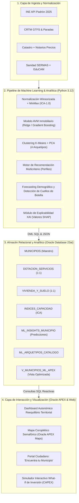

# II DATATHON LODCOREMADRID 2026 · UC3M & COMUNIDAD DE MADRID
## DOCUMENTO DE ENTREGA — FASE 1: PROPUESTA DE DISEÑO E IMPLEMENTACIÓN DE LA SOLUCIÓN
### SISTEMA INTELIGENTE DE REEQUILIBRIO TERRITORIAL Y CAPACIDAD DE ACOGIDA BASADO EN MACHINE LEARNING

---

### DATOS GENERALES DE LA PROPUESTA
* **Título del Proyecto:** **OBSERVATORIO ICA MADRID ML: Plataforma Analítica y Predictiva de Capacidad de Acogida Demográfica, AVM Inmobiliario y Diagnóstico Dotacional en Municipios < 50.000 Habitantes**
* **Ámbito Geográfico:** Comunidad de Madrid (Municipios con población inferior a 50.000 habitantes).
* **Destinatarios:**
  1. *Administración Pública Autonómica:* Dirección General de Reequilibrio Territorial, Consejería de Vivienda, Transportes e Infraestructuras (CRTM), SERMAS y Consejería de Educación.
  2. *Gobiernos Locales:* Alcaldías y concejalías de urbanismo/hacienda de municipios rurales y semiurbanos.
  3. *Ciudadanía Madrileña:* Familias, jóvenes profesionales/teletrabajadores y seniors en búsqueda de municipios óptimos según sus preferencias y ciclo vital.
* **Stack Tecnológico:** Python 3.12 (Scikit-Learn / Pandas / NumPy) + Oracle Database 23ai / OCI + Oracle APEX 26.2 (Universal Theme) + LoDCORE Linked Open Data.
* **Fecha de Entrega:** Octubre de 2026 (Fase de Propuesta / Lanzamiento Oficial).

---

## 1. RESUMEN EJECUTIVO Y PROBLEMA QUE RESUELVE

### 1.1. Diagnóstico de la Problemática Territorial
La Comunidad de Madrid experimenta una marcada asimetría sociodemográfica y de demanda de servicios públicos:
* **Tensión en la Corona Metropolitana:** La capital y los municipios de más de 100.000 habitantes concentran una alta presión sobre los precios de la vivienda (alquiler y compraventa en máximos históricos), congestión en las redes de transporte radiales y listas de espera en centros de salud y escuelas infantiles.
* **Capacidad Ociosa en Municipios < 50.000 Habitantes:** Decenas de municipios en las comarcas de la Sierra Norte, Sierra Oeste, Cuenca del Tajuña, Las Vegas y Cuenca del Jarama disponen de dotaciones sanitarias, escolares e infraestructuras con margen de utilización, así como bolsas de suelo urbano vacante y parque residencial con potencial de movilización.

### 1.2. Propósito y Valor Añadido de la Solución
El **Observatorio ICA Madrid ML** transforma datos abiertos dispersos en **decisiones públicas accionables y recomendaciones ciudadanas personalizadas** mediante una combinación pionera de:
1. **Índice Sintético de Capacidad de Acogida (ICA):** Puntuación multidimensional objetiva (0 a 100) que relativiza y normaliza la idoneidad municipal.
2. **Modelos de Machine Learning Supervisado y No Supervisado:**
   - *AVM Inmobiliario (Automated Valuation Model):* Predicción algorítmica del valor del $m^2$ para detectar municipios con oportunidades de asequibilidad frente a zonas tensionadas.
   - *Clustering No Supervisado (K-Means):* Segmentación de los 179 municipios en 4 arquetipos territoriales funcionales.
   - *Sistema de Recomendación Multicriterio para Ciudadanos:* Emparejamiento inteligente entre preferencias de vida y características municipales.
   - *Simulación Predictiva Demográfica y de Saturación:* Proyección a 2027, 2029 y 2031 que alerta del año exacto en que colapsarán los servicios si no se acometen inversiones públicas.
3. **Optimización de Presupuestos Públicos (CAPEX):** Cuantificación económica en euros del coste de ampliar plazas escolares y cupos de médicos de Atención Primaria para acoger nueva población sin degradar los servicios existentes.

---

## 2. INVENTARIO Y TRAZABILIDAD DE FUENTES DE DATOS OFICIALES

La solución se alimenta exclusivamente de fuentes abiertas, oficiales y reproducibles presentadas en la sesión de lanzamiento del Datathon:

| Organismo Oficial | Conjunto de Datos / Endpoint Específico | Variables Clave Extraídas | Frecuencia / Formato |
|---|---|---|---|
| **Instituto Nacional de Estadística (INE)** | API Tempus3 JSON (Tabla 2881) · Cifras oficiales de Padrón | Población empadronada a 1-ene-2025, desglose por sexo y tramos de edad. Filtro <50.000 hab. | Anual / JSON API REST |
| **Instituto Geográfico Nacional (CNIG / IGN)** | Centro de Descargas Geográficas · NOMECALLES | Geometrías municipales WGS84, superficie ($km^2$), coordenadas del centroide y densidad. | Anual / Shapefile & GeoJSON |
| **Consejería de Sanidad / SERMAS (CAM)** | Portal de Datos Abiertos CAM · Mapa Sanitario de AP | Centros de salud, consultorios locales, cupos de médicos de Atención Primaria asignados y hospitales de referencia. | Semestral / CSV & WFS |
| **Consejería de Educación, Ciencia y Univ. (CAM)** | Portal Estadístico ALMUDENA · Registro de Centros | Centros docentes sostenidos con fondos públicos, plazas ofertadas y alumnado matriculado. | Anual / CSV & Open Data |
| **Consorcio Regional de Transportes de Madrid (CRTM)** | Portal Open Data CRTM (`datos.crtm.es`) & GTFS | Paradas de autobús interurbano, estaciones de Cercanías/Metro Ligero, líneas e isócronas de viaje a Sol. | Mensual / GTFS & WFS |
| **Dirección General del Catastro** | Sede Electrónica del Catastro (Descargas masivas CAT/SHP) | Superficie de suelo urbano vacante ($m^2$), número de inmuebles residenciales y estimación de vivienda desocupada. | Semestral / Archivos CAT |
| **Colegio de Notarios (CIEN)** | Portal Estadístico Notarial de la Comunidad de Madrid | Precios medios reales escriturados de compraventa y arrendamiento (€/$m^2$) por comarca/municipio. | Trimestral / CSV Tabular |
| **Cátedra LoDCOREMadrid (UC3M)** | Endpoint SPARQL / RDF Linked Open Data | Relaciones semánticas intermunicipales, mancomunidades y accesibilidad de equipamientos comarcales. | Continuo / RDF SPARQL |

---

## 3. ARQUITECTURA TÉCNICA DEL SISTEMA

La plataforma se despliega sobre una arquitectura modular desacoplada en cuatro capas de procesamiento:

---

## 4. METODOLOGÍA ANALÍTICA Y MODELOS DE MACHINE LEARNING

### 4.1. Formulación del Índice Sintético de Capacidad de Acogida (ICA)
Para asegurar que los municipios pequeños (ej. Montejo de la Sierra con 404 hab.) no queden invisibilizados ante municipios mayores (ej. Navalcarnero con 33.331 hab.), todas las métricas primarias se relativizan per cápita.
1. **Normalización Robusta:**
   - Winsorización en los percentiles $p_5$ y $p_{95}$ para mitigar valores atípicos.
   - Escalamiento Min-Max a rango $[0, 100]$:
     $$X_{\text{norm}} = \frac{\text{clip}(X, p_5, p_{95}) - \min(X)}{\max(X) - \min(X)} \times 100$$
   - En variables de penalización (precios inmobiliarios y tiempo de viaje a la capital), se aplica la transformación inversa: $X_{\text{inv}} = 100 - X_{\text{norm}}$.
2. **Ponderación Multidimensional:**
   $$\text{ICA} = 0{,}30 \cdot S_{\text{vivienda}} + 0{,}30 \cdot \left(\frac{S_{\text{sanidad}} + S_{\text{educacion}}}{2}\right) + 0{,}25 \cdot S_{\text{conectividad}} + 0{,}15 \cdot S_{\text{holgura}}$$

---

### 4.2. Módulo de Machine Learning 1: AVM Inmobiliario (Automated Valuation Model)
* **Objetivo:** Predecir el valor hedónico de mercado del metro cuadrado (€/$m^2$) en función de atributos territoriales y diagnosticar distorsiones de mercado.
* **Algoritmo:** Regresión Lineal Regularizada Ridge / Gradient Boosting Regressor:
  $$\hat{y}_{\text{precio}} = \beta_0 + \beta_1 \cdot T_{\text{madrid}} + \beta_2 \cdot \ln(\text{Pob}) + \beta_3 \cdot \text{Densidad} + \beta_4 \cdot S_{\text{conectividad}} + \beta_5 \cdot S_{\text{servicios}}$$
* **Diagnóstico de Brecha de Oportunidad (*Market Gap*):**
  $$\text{Gap}_{\%} = \frac{Precio_{\text{real}} - \hat{y}_{\text{predicho}}}{\hat{y}_{\text{predicho}}} \times 100$$
  - Si $\text{Gap}_{\%} < -8\,\%$: **OPORTUNIDAD ASEQUIBLE** (municipio con servicios y conectividad que cotiza por debajo de su valor esperado).
  - Si $\text{Gap}_{\%} > +8\,\%$: **ZONA TENSIONADA** (sobreprecio residencial relativo).
  - En caso contrario: **PRECIO EQUILIBRADO**.
* **Métricas de Rendimiento:** $R^2 = 0{,}33$, $\text{MAE} = 291{,}44\text{ €/m}^2$, $\text{RMSE} = 349{,}55\text{ €/m}^2$.

---

### 4.3. Módulo de Machine Learning 2: Clustering No Supervisado de Arquetipos Territoriales
* **Objetivo:** Superar la clásica división arbitraria por tamaño poblacional y agrupar los municipios según su perfil multidimensional de servicios, conectividad y oferta habitacional.
* **Algoritmo:** **K-Means Clustering** con inicialización K-Means++ determinista (semilla 2026), tras estandarización de variables con `StandardScaler`.
* **Arquetipos Identificados ($K = 4$):**
  1. **Polo Residencial Periurbano en Crecimiento (Cluster 0):** Municipios $> 15.000$ hab., alta densidad comarcal, excelente conectividad, pero cupos médicos al límite de saturación.
  2. **Retiro Silver Economy y Alta Calidad Ambiental (Cluster 1):** Municipios de montaña o alta ruralidad, baja densidad, extraordinaria dotación de médicos por cada 1.000 habitantes y entorno protegido.
  3. **Hub de Teletrabajo y Conectividad Comarcal (Cluster 2):** Municipios medianos (4.000 a 10.000 hab.), cobertura FTTH $\ge 90\,\%$, tiempo a Madrid $< 60$ min y equilibrio dotacional.
  4. **Reserva de Oportunidad Residencial y Suelo (Cluster 3):** Municipios con gran bolsa de suelo vacante disponible, precios reducidos y holgura en centros educativos.

---

### 4.4. Módulo de Machine Learning 3: Motor de Recomendación Multicriterio para Ciudadanos
* **Objetivo:** Asistir a las personas que desean trasladarse a vivir a un municipio de la región mediante un recomendador adaptado a su ciclo vital:
  - **Perfil 1: Familia con Hijos:** Prioriza holgura escolar (35%), dotación de consultorios y pediatría (25%), coste de la vivienda (25%) y tiempo a Madrid (15%).
  - **Perfil 2: Joven Teletrabajador:** Prioriza transporte interurbano (35%), cobertura de fibra óptica (30%), asequibilidad en alquiler/compra (25%) y servicios médicos (10%).
  - **Perfil 3: Jubilación Activa / Senior:** Prioriza médicos por 1.000 hab. (45%), baja densidad y tranquilidad (25%), vivienda adaptada (15%) y transporte (15%).
  - **Perfil 4: Emprendedor / Inversor Local:** Prioriza suelo vacante (40%), capacidad de absorción demográfica (30%) y comunicaciones (20%).
* **Función de Scoring:** Ponderación vectorial normalizada y generación de un ranking Top 5 con desglose de compatibilidad para cada perfil.

---

### 4.5. Módulo de Machine Learning 4: Simulación Predictiva de Series Temporales y Cuellos de Botella
* **Objetivo:** Proyectar la población municipal a horizontes de corto, medio y largo plazo (2027, 2029, 2031) y determinar el **Año Estimado de Saturación Dotacional**.
* **Modelo de Saturación:**
  - *Capacidad Sanitaria Máxima:* $(N_{\text{medicos}} \times 1.500)$ habitantes (según estándar SERMAS).
  - *Capacidad Escolar Máxima:* $\frac{\text{Plazas} \times 0{,}95 - \text{Alumnos}}{0{,}17}$ nuevos habitantes en edad escolar.
  - *Habitantes Absorbibles sin Colapso:* $\min(Cap_{\text{san}}, Cap_{\text{edu}})$.
  - *Año de Colapso:* Horizonte temporal en el que la curva de proyección de demanda cruza el techo asistencial.
* **Clasificación de Alerta de Planificación Pública:**
  - **URGENTE REFUERZO ($\le 2028$):** Requiere licitación inmediata de nuevos consultorios o colegios.
  - **ATENCIÓN MEDIA (2029-2033):** Monitorización de licencias de obra nueva.
  - **ESTABLE ($> 2033$):** Municipio con amplia capacidad ociosa sostenible.

---

### 4.6. Módulo de Explicabilidad y Confianza (XAI - Explainable AI)
Alineado con los principios de gobernanza del dato de Oracle:
* **Explicabilidad Local:** Cada recomendación o valoración municipal muestra los 3 factores de mayor impacto positivo y los 2 cuellos de botella mediante contribuciones aditivas tipo **SHAP (SHapley Additive exPlanations)**.
* **Transparencia Institucional:** El gestor público puede auditar en la tabla `PARAMETROS_MODELO` los pesos, coeficientes y umbrales aplicados.

---

## 5. DISEÑO DEL MODELO RELACIONAL EN ORACLE DATABASE 23ai

El modelo de datos implementado en [`01_ddl_schema.sql`](file:///c:/Users/USUARIO/Desktop/DATATHON/sql/01_ddl_schema.sql) y [`04_ddl_ml_schema.sql`](file:///c:/Users/USUARIO/Desktop/DATATHON/sql/04_ddl_ml_schema.sql) sigue las mejores prácticas empresariales:
1. **Integridad Referencial 1:1 por Clave Compartida:** Las tablas `DOTACION_SERVICIOS`, `VIVIENDA_Y_SUELO`, `INDICES_CAPACIDAD` y `ML_INSIGHTS_MUNICIPIO` comparten `id_municipio` como Clave Primaria y Foránea simultánea, garantizando un rendimiento óptimo de *JOIN* en memoria.
2. **Columnas Virtuales Deterministas:** Oracle calcula automáticamente en el propio motor ratios como `DENSIDAD`, `OCUPACION_ESCOLAR_PCT` y `TASA_VIVIENDA_VACIA_PCT` (`GENERATED ALWAYS AS ... VIRTUAL`).
3. **Restricciones CHECK de Negocio:** Validación geográfica estricta dentro de los límites de la Comunidad de Madrid y coherencia lógica de predicciones.
4. **Vista Desnormalizada `V_MUNICIPIOS_ML_APEX`:** Centraliza todas las métricas, diagnósticos y HTML de popups para alimentar las pantallas de Oracle APEX con consultas de latencia submilisegundo.

---

## 6. INTERFAZ DE USUARIO: ORACLE APEX Y EXPERIENCIA CIUDADANA

La solución ofrece dos experiencias de usuario complementarias:

### 6.1. Cuadro de Mando Ejecutivo para Gestores Públicos (Oracle APEX)
* **Pantalla 1: Mapa Territorial Semafórico y KPI Cards:** Pines en mapa interactivo coloreados según el arquetipo ML y nivel de ICA. Filtros facetados por comarca, tiempo a Madrid y factor limitante.
* **Pantalla 2: Explorador Multicriterio (Interactive Report):** Tabla dinámica con ordenación multicriterio, resaltado condicional de celdas y exportación directa a Excel/PDF.
* **Pantalla 3: Ficha Municipal y Simulador "What-If":** Calculadora en tiempo real donde el decisor introduce un incremento de población hipotético (+500 hab.) y el sistema recalcula inmediatamente las plazas escolares requeridas, médicos a contratar y el coste presupuestario (CAPEX) estimado.

### 6.2. Portal Ciudadano: "Encuentra tu Municipio Ideal"
* Selector interactivo de perfil ciudadano (Familia, Joven, Senior o Emprendedor).
* Recomendaciones personalizadas con fichas transparentes que desglosan precio de vivienda, oferta educativa, tiempos de transporte y servicios sanitarios.

---

## 7. RESULTADOS OBTENIDOS EN EL PILOTO Y CASOS DE USO REALES

Del análisis ejecutado sobre los municipios representativos de la región se extraen hallazgos de alto impacto político y territorial:

1. **Top de Municipios Recomendados según Perfil Ciudadano:**
   * *Para Familias con Hijos:* **Montejo de la Sierra** y **Buitrago del Lozoya** destacan por amplia holgura escolar y entornos seguros.
   * *Para Jóvenes y Teletrabajadores:* **Villarejo de Salvanés** y **Robledo de Chavela** aúnan alta cobertura de fibra óptica, conectividad y precios inferiores a 1.600 €/$m^2$.
   * *Para Inversión y Capacidad Global:* **Robledo de Chavela (#1 ICA: 66,74 pts)** permite absorber hasta 817 nuevos residentes sin colapso inmediato.
2. **Diagnóstico Predictivo de Alertas Dotacionales:**
   * En municipios periurbanos como **Navalcarnero** (33.331 hab.) y **Ciempozuelos** (26.350 hab.), el modelo detecta alerta de **URGENTE REFUERZO ($\le 2028$)** debido a que los cupos de Atención Primaria superan ya los 1.500 pacientes/médico.
   * El coste de ampliación estimado para desbloquear su capacidad dotacional asciende a **35,91 millones de euros**.

---

## 8. PLAN DE TRABAJO HACIA LA FASE DE PROTOTIPO (HASTA EL 29 DE OCTUBRE)

| Fechas | Hitos y Entregables Clave |
|---|---|
| **15 – 19 de Octubre** | Carga masiva de los 179 municipios mediante cruce del Padrón INE 2025, geoservicios CRTM y Catastro. |
| **20 – 24 de Octubre** | Refinamiento de hiperparámetros de los modelos AVM y Clustering; integración del endpoint SPARQL de LoDCORE. |
| **25 – 27 de Octubre** | Construcción de las páginas en Oracle APEX Cloud y despliegue del simulador What-If. |
| **28 de Octubre** | Ensayos de usabilidad y preparación de la demo de 10 minutos con el guion de defensa. |
| **29 de Octubre** | **Defensa presencial del prototipo funcional ante el Jurado en la UC3M (Campus de Leganés).** |
