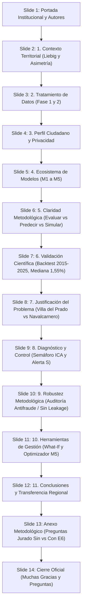

# GUION MAESTRO DE PRESENTACIÓN · II DATATHON LoDCOREMadrid 2026
## Defensa Oficial: Diapositivas Institucionales (14 Slides) + Demostración Web en Vivo
**Fecha de defensa:** 29 de octubre de 2026 · Salón de Grados, Campus de Leganés, UC3M  
**Tiempo oficial de exposición:** 10 minutos (+ turno de preguntas del jurado)  
**Proyecto:** MadridNext · Capacidad de Acogida Territorial Sostenible (< 50.000 hab.)  
**Equipo:** Adrián Hernando Muñoz · Juan Torrero de Pablo · Alejandro Cuntin Bariteau  
**Archivo de la Presentación:** `presentacion_datathon_madridnext.pptx` (y `presentacion_datathon_oficial_actualizada.pptx`)  
**Portal Web en Vivo:** `http://localhost:8088/index.html` | Mapa: `http://localhost:8088/mapa/mapa.html`

---

## 1. Estructura de la Presentación (14 Diapositivas)

---

## 2. Cronograma de Exposición (10 Minutos)

| Tramo | Diapositivas / Soporte | Bloque Temático | Ponente / Mensaje Clave |
|:---:|:---:|---|---|
| **00:00 – 01:00** | Slide 1 – Slide 2 | **Portada y Reto Territorial** | Asimetría metropolitana y Principio de Liebig: *un consultorio saturado no se compensa con aire puro*. |
| **01:00 – 02:30** | Slide 3 – Slide 4 | **Ingesta, Calidad y Perfil Ciudadano** | Fases 1 y 2 (datos reales vs. estimados). Paridad Python / Oracle APEX sin almacenar datos personales. |
| **02:30 – 04:00** | Slide 5 – Slide 6 | **Modelos M1–M5 y Claridad de Conceptos** | Cinco modelos escribiendo en la misma ficha. Diferencia crucial: Evaluar vs. Predecir vs. Simular. |
| **04:00 – 06:30** | **DEMO WEB EN VIVO** | **Navegación Interactiva (Portal + Mapa)** | Portada KPIs $\rightarrow$ Recomendador Ciudadano $\rightarrow$ Simulador What-If $\rightarrow$ Mapa semafórico. |
| **06:30 – 07:45** | Slide 7 – Slide 8 | **Validación Científica y Paradoja Demográfica** | Backtesting 2015–2025 (error mediano 1,55%). Por qué los que más crecen tienen menor capacidad. |
| **07:45 – 09:00** | Slide 9 – Slide 11 | **Diagnóstico, Semáforo ICA y Herramientas** | Semáforo ICA, Alerta dura S. Auditoría antifraude. What-if y Optimizador comarcal (2 M€). |
| **09:00 – 10:00** | Slide 12 – Slide 14 | **Transferencia, Anexo de Respuestas y Cierre** | Escalabilidad a 155 municipios. Respuestas blindadas al jurado. Agradecimiento y turno de preguntas. |

---

## 3. Guion Diapositiva a Diapositiva

### Slide 1: Portada Institucional
* **Título:** MadridNext: Capacidad de Acogida Territorial
* **Subtítulo:** Herramienta analítica de planificación territorial para municipios de menos de 50.000 habitantes en la Comunidad de Madrid.
* **Autores:** Adrián Hernando Muñoz · Juan Torrero de Pablo · Alejandro Cuntin Bariteau.
* **Institución:** II Datathon LoDCOREMadrid 2026 · Cátedra I+D+i Universidad Carlos III de Madrid y Comunidad de Madrid.
* **Voz del ponente:**
  > *"Buenos días a los miembros del jurado, representantes de la Universidad Carlos III y de la Comunidad de Madrid.  
  > La corona metropolitana concentra el 85 % de la población en un 12 % del territorio, tensionando precios y servicios, mientras que en nuestros municipios menores de 50.000 habitantes existe espacio, calidad de vida y oportunidades.  
  > Pero trasladar población sin medir la capacidad genera colapso dotacional. Hoy presentamos **MadridNext**, un sistema analítico riguroso y honesto para responder a dos preguntas fundamentales: **¿dónde hay margen real para absorber población sin romper los servicios esenciales?** y **¿cómo orientar la inversión pública para desatascar esos cuellos de botella?**"*

---

### Slide 2: 1. Contexto Territorial
* **Puntos clave:**
  - **Asimetría Territorial:** 20 municipios analizados con capacidad neta de +108.400 habitantes, pero distribuidos de forma sumamente dispar.
  - **Ley del Mínimo de Liebig:** Un ecosistema territorial colapsa por el recurso más escaso. No sirve tener suelo barato si el colegio está al 98 % o el cupo médico excede 1.500 hab/médico.
  - **La Paradoja del Atractivo vs. Capacidad:** El mercado empuja hacia donde la vivienda es barata, pero si ese municipio no tiene dotaciones, el crecimiento degrada la calidad de vida de todos los residentes.

---

### Slide 3: 2. Tratamiento de Datos (Fases 1 y 2)
* **Fase 1 (Recopilación y Trazabilidad):**
  - Fuentes 100 % oficiales: INE (tabla 2881 y padrón continuo), Nomisma/Idealista, Portal de Datos Abiertos CAM (centros sanitarios y educativos), Censo de Población y Viviendas.
  - Etiquetado exhaustivo: cada variable se documenta como **Dato Real Observado** o **Estimación Calibrada**, impidiendo el sobreajuste (overfitting).
* **Fase 2 (Control de Calidad y Validaciones):**
  - Existencia del 100 % de columnas normativas.
  - Ausencia absoluta de valores nulos o registros huérfanos.
  - Unicidad de registros: sin duplicidad de municipios.
  - Filtro geográfico estricto: población entre 1 y 49.999 habitantes.
  - Consistencia matemática: precios inmobiliarios y ratios dotacionales estrictamente positivos.

---

### Slide 4: 3. Perfil Ciudadano y Privacidad
* **Ponderación de Preferencias:**
  - El ciudadano introduce: presupuesto total (€/m²), ingresos netos del hogar (para ratio de esfuerzo), tiempo máximo de commute, medio de transporte (público/privado), número y edad de hijos, edad y régimen de tenencia (compra/alquiler).
  - `/config/perfil.py` calcula los pesos multicriterio ponderados.
* **Separación de Arquitecturas y Paridad:**
  - Python ordena los 20 municipios del CSV usando los pesos.
  - Oracle APEX ordena los 20 municipios de la tabla relacional con los mismos pesos.
  - Un test automatizado verifica que ambas rutas producen exactamente el mismo orden. Son dos caminos paralelos e independientes: APEX funciona sin depender de Python.
* **Privacidad Absoluta por Diseño:**
  - La base de datos Oracle **NO guarda los datos personales** del ciudadano.
  - Solo almacena las 5–6 reglas genéricas de ponderación (p. ej. *“cada hijo suma +0,05 al peso educativo”*). Los datos del ciudadano se procesan como parámetros volátiles en memoria.

---

### Slide 5: 4. Ecosistema de Modelos Analíticos
* **Cinco Modelos en una Ficha Municipal Única:**
  - **M1:** *¿Puedo permitirme vivir aquí?* $\rightarrow$ Precio €/m² hedónico y esfuerzo financiero familiar.
  - **M2:** *¿Qué tal servicios y conexión?* $\rightarrow$ 4 subíndices normalizados (0–100) y radar dotacional.
  - **M3:** *¿Va a crecer o vaciarse?* $\rightarrow$ Proyección demográfica a 5 y 10 años (2030 / 2035).
  - **M4:** *¿Cuánta gente cabe y qué se rompe?* $\rightarrow$ Índice de Capacidad de Acogida (ICA) y semáforo.
  - **M5:** *¿Cuál encaja conmigo?* $\rightarrow$ Ranking de encaje ciudadano y optimizador comarcal.
* **Frase clave:**
  > *"M1 dice si es asequible, M2 si tiene servicios, M3 si va a crecer, M4 cuánta gente cabe y M5 cuál te conviene. Los cinco escriben en la misma ficha municipal."*

---

### Slide 6: 5. Claridad Metodológica (Las Tres Operaciones)
* **Distinción analítica fundamental:**
  1. **Evaluar / Ordenar:** *“¿Qué municipio encaja con lo que pido?”* $\rightarrow$ No necesita datos del futuro; opera con datos observables actuales (Ranking M5).
  2. **Predecir:** *“¿Qué población tendrá este municipio en 2030?”* $\rightarrow$ Sí requiere estimar un valor futuro desconocido (M3 extrapolación geométrica calibrada).
  3. **Simular:** *“¿Qué pasa si llegan 2.000 personas o invierto 1 M€?”* $\rightarrow$ No requiere futuro; es un recálculo determinista con reglas de capacidad (Simulador What-if y Optimizador).

---

### Slide 7: 6. Validación Científica (Backtesting 2015–2025)
* **¿Cómo sabemos que nuestro modelo ICA es bueno?**
  - El ICA mide capacidad de acogida, no atractivo comercial.
  - Contrastamos la capacidad con el crecimiento real mediante un **backtesting temporal estricto**:
    1. Población real 2015 y 2020 de cada municipio.
    2. Cálculo de la tasa anual histórica.
    3. Proyección a 5 años hacia adelante (predicción 2025).
    4. Comparación con el censo real de 2025 del INE.
    5. Medición de la desviación real.
* **Resultados Verificados:**
  - **Error mediano del 1,55 %** a 5 años (frente al 7,02 % del escenario inercial o naive).
  - En un municipio de 5.000 habitantes, la desviación mediana es de solo **78 personas**.
  - Ejemplos del panel:
    - *Robledo de Chavela:* Predicho 4.815 vs Real 4.818 $\rightarrow$ Diferencia: -3 (-0,06 %).
    - *Manzanares el Real:* Predicho 9.610 vs Real 9.648 $\rightarrow$ Diferencia: -38 (-0,39 %).
    - *Buitrago del Lozoya:* Predicho 2.058 vs Real 2.034 $\rightarrow$ Diferencia: +24 (+1,17 %).
    - *Meco:* Predicho 16.219 vs Real 15.922 $\rightarrow$ Diferencia: +297 (+1,86 %).

---

### Slide 8: 7. Justificación del Problema (La Predicción Honesta)
* **La prueba de fuego del ICA:**
  - Preguntamos a los datos: *“¿Los municipios con mayor ICA son los que de verdad crecen más?”*
  - Correlación de Spearman observada: $\rho = 0,10$ (estadísticamente no significativa).
  - **Conclusión honesta:** El ICA **no predice el crecimiento espontáneo del mercado**. Mide capacidad física y de servicios.
* **El Hallazgo que Justifica MadridNext:**
  - Los municipios que más población han absorbido recientemente son precisamente los que **menor capacidad dotacional tienen**:
    - **Villa del Prado:** Crecimiento +16,2 %, pero ICA colapsado en **36,9**.
    - **Navalcarnero:** Crecimiento +11,2 %, pero ICA colapsado en **24,5**.
  - Este desajuste demuestra que el crecimiento sin planificación tensiona servicios críticos, justificando la necesidad imperativa de MadridNext para la Consejería.

---

### Slide 9: 8. Diagnóstico y Control (Semáforo y Alerta S)
* **El Semáforo ICA (0 a 100):**
  - 🟢 **ALTA (≥ 60):** Mucho margen; el municipio puede absorber nuevos habitantes con holgura dotacional.
  - 🟡 **MEDIA (40–59):** Margen justo; absorbible con inversiones puntuales en servicios.
  - 🔴 **BAJA (< 40):** Sin margen dotacional; si llega más población, los servicios colapsan.
* **La Regla Dura: Alerta No Compensatoria (S):**
  - Se activa si: $\text{hab/médico} > 1.500$ **O** $\text{ocupación escolar} > 95\,\%$.
  - Significa: hay un servicio crítico saturado que no se puede promediar con nada.
  - **Consecuencias automáticas:**
    - La capacidad de acogida se trunca de inmediato por debajo de 40.
    - El índice de encaje ciudadano máximo se bloquea en 39 (ejemplo: *Cercedilla* obtiene encaje 34,61 con Alerta S).

---

### Slide 10: 9. Robustez Metodológica (Auditoría Antifraude)
* **Garantía Científica: Aprender vs. Memorizar:**
  - Verificamos exhaustivamente que el modelo no haga trampas memorizando datos en vez de aprender patrones reales.
* **Tipos de trampa prevenidos:**
  - *Data leakage* temporal (mirar datos del futuro como población de años posteriores).
* **Método de Auditoría Implementado:**
  - Construcción y comparación de dos versiones del modelo: **Honesta vs. Tramposa**.
  - Validación cruzada Out-Of-Fold (OOF): se utilizan unos municipios para entrenar y otros totalmente distintos para evaluar.
  - M1 presenta $R^2$ OOF negativo con $N=20$, lo que comunicamos con total honestidad técnica en lugar de sobreajustar artificialmente.

---

### Slide 11: 10. Herramientas para la Gestión (What-If y Optimizador M5)
* **Simulador What-If Institucional:**
  - Pregunta del gestor: *“Si entran 2.000 personas en este pueblo, ¿qué pasa?”*
  - Respuesta inmediata del motor: recalcula al instante la ratio hab/médico, la ocupación escolar y el nuevo ICA, alertando del servicio que se rompe primero.
* **Optimizador Presupuestario M5 (Programación Lineal Simplex):**
  - Pregunta del gestor: *“Tengo 2.000.000 € de inversión regional, ¿dónde los reparto en la Sierra Oeste?”*
  - El algoritmo resuelve la asignación óptima eliminando cuellos de botella:
    - *Villa del Prado:* 450.000 € (refuerzo médico) $\rightarrow$ +830 personas acogibles.
    - *San Martín de Valdeiglesias:* 600.000 € (50 plazas escolares) $\rightarrow$ +279 personas.
    - *Robledo de Chavela:* 600.000 € (50 plazas escolares) $\rightarrow$ +227 personas.
    - *Navalcarnero:* 0 € (su cuello de botella no es dotacional, gastar aquí sería ineficiente).

---

### Slide 12: 11. Conclusiones y Transferencia Regional
* **Síntesis del Reto:**
  - Se entrega un sistema de soporte a la decisión integral, reproducible y en producción local.
  - 36 tests unitarios y de integración superados al 100 %.
* **Escalabilidad Regional:**
  - Arquitectura preparada para expandir el panel piloto de 20 municipios a los **155 municipios rurales y periurbanos de la Comunidad de Madrid**.
  - Integración directa en Oracle Database 23ai y APEX sin costes de licenciamiento adicionales.

---

### Slide 13: Anexo Metodológico (Defensa ante el Jurado)
* **Tabla Comparativa de Blindaje:**

| Pregunta del Jurado | Sin MadridNext (Respuesta Débil) | Con MadridNext (Nuestra Respuesta Rigurosa) |
|---|---|---|
| **¿Cómo sé que el índice sirve?** | Silencio incómodo o evasivas. | *"Mide capacidad de acogida; lo contrastamos con el crecimiento censal real y los municipios tensionados quedan identificados."* |
| **¿Vuestras proyecciones son fiables?** | *"Creemos que sí."* | *"Tienen un 1,55 % de error mediano, medido y contrastado en dos ventanas temporales del INE."* |
| **¿Por qué no usáis ML más complejo?** | *"Porque no."* | *"Con 20 municipios y sin etiqueta supervisada, un modelo profundo memorizaría; lo demuestra el backtest y el $R^2$ OOF de M1."* |
| **¿Qué no habéis validado?** | Sorpresa o titubeo. | *"Que el índice anticipe el crecimiento espontáneo del mercado ($\rho=0,10$). Mide capacidad, no atractivo, y por eso no lo afirmamos."* |

---

### Slide 14: Cierre Oficial
* **Mensaje Central:**
  > **Muchas gracias por su atención**  
  > **¿Preguntas?**
* **Firma del Equipo:**
  - Adrián Hernando Muñoz · Juan Torrero de Pablo · Alejandro Cuntin Bariteau
  - Cátedra I+D+i LoDCOREMadrid · Campus de Leganés, Universidad Carlos III de Madrid.
