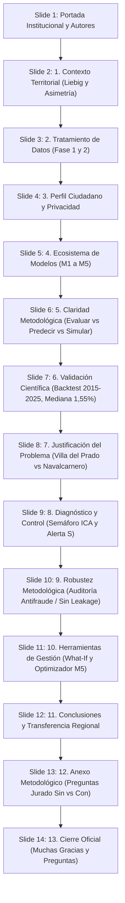

# GUION MAESTRO DE PRESENTACIÓN · II DATATHON LoDCOREMadrid 2026
## Defensa Oficial: Diapositivas Institucionales (14 Slides) + Demostración Web en Vivo
**Fecha de defensa:** 29 de octubre de 2026 · Salón de Grados, Campus de Leganés, UC3M  
**Tiempo oficial de exposición:** 10 minutos (+ turno de preguntas del jurado)  
**Proyecto:** MadridNext · Capacidad de Acogida Territorial Sostenible (< 50.000 hab.)  
**Equipo:** Adrián Hernando Muñoz · Juan Torrero de Pablo · Alejandro Cuntin Bariteau  
**Archivo de la Presentación:** `presentacion_datathon_madridnext.pptx` (y `presentacion_datathon_oficial.pptx`)  
**Portal Web en Vivo:** `http://localhost:8088/index.html` | Mapa: `http://localhost:8088/mapa/mapa.html`

---

## 1. Estructura de la Presentación (14 Diapositivas)

---

## 2. Cronograma de Exposición (10 Minutos)

| Tramo | Diapositivas / Soporte | Bloque Temático | Ponente / Mensaje Clave |
|:---:|:---:|---|---|
| **00:00 – 01:00** | Slide 1 – Slide 2 | **Portada y Reto Territorial** | Asimetría metropolitana (80% en el área central) y Principio de Liebig: *un consultorio saturado no se compensa con aire puro*. |
| **01:00 – 02:30** | Slide 3 – Slide 4 | **Ingesta, Calidad y Perfil Ciudadano** | Fases 1 y 2 (datos reales vs. estimados). Paridad Python / Oracle APEX sin almacenar datos personales (RGPD). |
| **02:30 – 04:00** | Slide 5 – Slide 6 | **Modelos M1–M5 y Claridad de Conceptos** | Cinco modelos escribiendo en la misma ficha. Diferencia crucial: Evaluar vs. Predecir vs. Simular. |
| **04:00 – 06:30** | **DEMO WEB EN VIVO** | **Navegación Interactiva (Portal + Mapa)** | Portada KPIs $\rightarrow$ Recomendador Ciudadano $\rightarrow$ Simulador What-If $\rightarrow$ Mapa semafórico. |
| **06:30 – 07:45** | Slide 7 – Slide 8 | **Validación Científica y Paradoja Demográfica** | Backtesting 2015–2025 (error mediano 1,55%). Por qué los que más crecen tienen menor capacidad ($\rho=0,10$). |
| **07:45 – 09:00** | Slide 9 – Slide 11 | **Diagnóstico, Semáforo ICA y Herramientas** | Semáforo ICA, Alerta dura S. Auditoría antifraude (73 tests). What-if y Optimizador comarcal (2 M€). |
| **09:00 – 10:00** | Slide 12 – Slide 14 | **Transferencia, Anexo de Respuestas y Cierre** | Escalabilidad a 155 municipios. Respuestas blindadas al jurado. Agradecimiento y turno de preguntas. |

---

## 3. Guion Diapositiva a Diapositiva

### Slide 1: Portada Institucional
* **Título:** MadridNext: Capacidad de acogida territorial
* **Subtítulo:** Herramienta de diagnóstico dotacional y optimización presupuestaria para municipios de menos de 50.000 habitantes
* **Ámbito:** 155 municipios en la región (20 en el panel piloto).
* **Cita lema:**  
  *«El crecimiento demográfico regional no debe planificarse por intuición ni por mero atractivo inmobiliario. MadridNext ofrece a la Administración y a la ciudadanía una base objetiva para identificar techos dotacionales, prever cuellos de botella y priorizar inversiones públicas.»*
* **Autores:** Adrián Hernando Muñoz · Juan Torrero de Pablo · Alejandro Cuntin Bariteau.
* **Institución:** II Datathon LoDCOREMadrid 2026 · Cátedra I+D+i Universidad Carlos III de Madrid y Comunidad de Madrid.

---

### Slide 2: 1 · Contexto Territorial
* **Título:** Asimetría demográfica y no compensación
* **Subtítulo:** Diagnóstico de partida en los 155 municipios de menos de 50.000 habitantes
* **Puntos clave:**
  - **Concentración Metropolitana (80%):** El 80% de la población regional vive en el área metropolitana central: congestión viaria severa, vivienda cara y tensión asistencial. Los 155 municipios restantes tienen potencial, pero antes hay que medir cuánto aguantan.
  - **La Paradoja del Atractivo (Menor precio ≠ mayor capacidad):** Un municipio asequible puede no tener plazas escolares ni médicos para nuevas familias. Atraer población donde no hay holgura traslada el colapso al entorno rural.
  - **Regla de No Compensación (Principio de Liebig):** Según la ley del mínimo de Liebig, la falta de sanidad o educación no se compensa con suelo ni zonas verdes. Más de 1.500 hab/médico o aulas al 95%: el índice queda por debajo de 40 puntos.

---

### Slide 3: 2 · Tratamiento de Datos
* **Título:** Datos trazables: qué es real y qué es estimado
* **Subtítulo:** Fase 1, ingesta y etiquetado de fuentes. Fase 2, control de calidad.
* **Fase 1 · Ingesta y Fuentes Oficiales:**
  - **INE:** Padrón continuo (tabla 2881) y migraciones. Población histórica y saldo neto (datos reales observados).
  - **CAM:** Datos abiertos de la Comunidad (CKAN). Centros de salud en alta (SERMAS) y red de centros educativos.
  - **Catastro:** Dirección General del Catastro, 2026. Valor catastral medio residencial (€/m²) y volumen edificado.
  - **CRTM:** Consorcio Regional de Transportes. Zonas tarifarias e isócronas medias a Madrid.
  - *Regla de honestidad:* Cada variable lleva su etiqueta explícita REAL o ESTIMADO para evitar el sobreajuste (*overfitting*).
* **Fase 2 · Control de Calidad y Auditoría:**
  - **92** columnas del panel verificadas.
  - **0** valores ausentes en las variables de modelado.
  - **20** códigos INE únicos, sin repetidos.
  - **73** pruebas automatizadas continuas en verde (100% pasando).
  - Filtro: municipios entre 1 y 49.999 habitantes, y precios, ocupaciones y cupos positivos.
  - Dataset congelado: `data/validated/municipios_panel_validado.csv`.

---

### Slide 4: 3 · Perfil Ciudadano y Privacidad
* **Título:** Perfil ciudadano y privacidad por diseño
* **Subtítulo:** Python y Oracle como caminos paralelos, con garantía de privacidad (RGPD)
* **Lo que introduce el ciudadano:**
  - Presupuesto de vivienda (total o €/m²).
  - Ingresos netos del hogar (esfuerzo sostenible < 30%).
  - Tiempo máximo de conexión (minutos al trabajo o a Madrid).
  - Modo de transporte (público CRTM o vehículo privado).
  - Composición familiar (hijos y edades: ajusta plazas escolares).
  - Régimen de tenencia (compra o alquiler).
  - *Módulo:* `config/perfiles.py` convierte las respuestas en pesos que suman 1,0 y reordena los municipios sin tocar el ICA objetivo.
* **Dos caminos paralelos y Privacidad:**
  - Python lee el CSV validado; Oracle APEX funciona de forma autónoma sin llamar a Python.
  - Los tests comprueban que ambos caminos producen exactamente los mismos pesos y rankings.
  - *Privacidad estricta (RGPD):* Oracle **no guarda ningún dato personal**, solo reglas de ponderación (ej.: *cada hijo suma 0,05 a educación*). Los datos del ciudadano son parámetros volátiles de sesión y nunca se escriben en disco.

---

### Slide 5: 4 · Ecosistema de Modelos
* **Título:** Cinco modelos, una ficha municipal
* **Lema:** *«M1 dice si es asequible, M2 si tiene servicios, M3 si va a crecer, M4 cuánta gente cabe y M5 cuál te conviene»*
* **Los 5 modelos:**
  - **M1 · Asequibilidad y precio (AVM):** ¿Puedo permitirme vivir aquí? Precio predicho (€/m²), esfuerzo familiar (% de la renta) y brecha de mercado.
  - **M2 · Dotación e infraestructuras:** ¿Qué tal servicios y conexión? Cuatro subíndices de 0 a 100: sanidad, educación, conectividad y calidad residencial.
  - **M3 · Demografía y series temporales:** ¿Va a crecer o a vaciarse? Proyección a 5 y 10 años (2030 y 2035) y año estimado de saturación.
  - **M4 · Capacidad neta de carga (ICA):** ¿Cuánta gente cabe y qué se rompe? Habitantes adicionales sostenibles e identificación del factor limitante.
  - **M5 · Recomendador y optimizador:** ¿Cuál encaja conmigo? Ranking adaptado al perfil ciudadano y optimización de la inversión pública.

---

### Slide 6: 5 · Claridad Metodológica
* **Título:** Evaluar, predecir y simular no es lo mismo
* **Subtítulo:** Evaluar el presente, predecir el futuro y simular escenarios
* **Distinción analítica:**
  1. **Evaluar / Ordenar:** *¿Qué municipio encaja con lo que pido?*  
     - *Necesita:* Ningún dato del futuro; lo observado ya existe hoy.  
     - *Función:* Reordenar municipios según preferencias declaradas.  
     - *Implementación:* Ranking adaptativo por perfiles (C2 / M5).
  2. **Predecir:** *¿Qué pasará en este municipio en 2030?*  
     - *Necesita:* Estimar una incógnita futura con series temporales.  
     - *Función:* Anticipar población y año de saturación.  
     - *Implementación:* Modelo M3 (población 2030/2035 y año de colapso).
  3. **Simular:** *¿Qué pasa si invierto X o llegan N personas?*  
     - *Necesita:* No predice: recalcula con reglas normativas ante supuestos (*what-if*).  
     - *Función:* Medir impacto presupuestario y cuellos de botella.  
     - *Implementación:* Simulador what-if y optimizador Simplex.

---

### Slide 7: 6 · Validación Científica
* **Título:** ¿Cómo sabemos que el modelo es bueno?
* **Subtítulo:** Proyectamos de 2020 a 2025 sin ver el dato real y lo comparamos con el padrón oficial
* **Metodología de 5 pasos:**
  1. Población real de 2015 y 2020 (INE).
  2. Tasa anual geométrica de crecimiento.
  3. Proyección a 2025 sin ver el dato real.
  4. Contraste con el padrón oficial de 2025.
  5. Medición del error en porcentaje y habitantes.
* **Métricas clave:**
  - **1,55%** error mediano de nuestra proyección a 5 años.
  - **7,02%** error mediano si se asume que nada cambia (inercial).
  - *La mitad de los municipios queda por debajo del 1,55%. En uno de 5.000 habitantes, el desvío típico ronda las 78 personas.*
* **Resultados por municipio:**
  - Robledo de Chavela: Pred 4.815 vs Real 4.818 $\rightarrow$ **−3 hab. (0,06%)**
  - Manzanares el Real: Pred 9.610 vs Real 9.648 $\rightarrow$ **−38 hab. (0,39%)**
  - Buitrago del Lozoya: Pred 2.058 vs Real 2.034 $\rightarrow$ **+24 hab. (1,17%)**
  - Meco: Pred 16.219 vs Real 15.922 $\rightarrow$ **+297 hab. (1,86%)**
  - Chinchón: Pred 5.390 vs Real 5.800 $\rightarrow$ **−410 hab. (7,07%)**
  - Villa del Prado: Pred 6.918 vs Real 7.743 $\rightarrow$ **−825 hab. (10,66%)**
  - Montejo de la Sierra: Pred 354 vs Real 404 $\rightarrow$ **−50 hab. (12,31%)**

---

### Slide 8: 7 · Justificación del Problema
* **Título:** El ICA mide capacidad, no atractivo
* **Subtítulo:** Esa paradoja justifica la herramienta: crece más quien menos capacidad tiene
* **El límite, dicho con honestidad:**
  - **$\rho = 0,10$:** Correlación entre el ICA y el crecimiento espontáneo (no significativa).
  - El ICA mide dónde hay infraestructura para crecer sin colapsar servicios. La gente no se muda adonde sobran plazas escolares, sino adonde hay alquiler barato o inercia urbana.
* **Los que más crecen, menos capacidad tienen:**
  - **Villa del Prado (+16,2% entre 2020 y 2025):** Capacidad BAJA (ICA 36,9). Centro de salud y consultorios sobrecargados.
  - **Navalcarnero (+11,2% / 31.979 hab.):** ALERTA ROJA (ICA 24,5), con 1.667 hab/médico y aulas al 95,2%.
  - *Conclusión:* Sin intervención, la inercia seguirá llenando municipios ya saturados. MadridNext reorienta ese flujo hacia donde hay capacidad real.

---

### Slide 9: 8 · Diagnóstico y Control
* **Título:** El semáforo ICA y la alerta no compensatoria
* **Subtítulo:** Umbrales de capacidad e interrupción automática del encaje
* **El Semáforo:**
  - 🟢 **ALTA (≥ 60):** Mucho margen de acogida. Absorbe población de inmediato sin comprometer colegios ni consultorios (ej.: Robledo 66,7 y Buitrago 62,5).
  - 🟡 **MEDIA (40–59):** Margen justo, condicionado. Admite nuevos vecinos si se acompaña de inversiones puntuales en refuerzo de servicios.
  - 🔴 **BAJA (< 40):** Sin margen: saturación. Servicios esenciales en situación crítica: más vecinos provocan el colapso dotacional.
* **Alerta S · No Compensatoria:**
  - Se activa con más de 1.500 hab/médico o una ocupación escolar superior al 95%.
  - El ICA total se trunca por debajo de 40 y el encaje máximo para cualquier ciudadano queda en 39, aunque la vivienda sea barata o sobren zonas verdes.
  - *Ejemplo:* Cercedilla presenta puntuación teórica de 34,61, clasificada con alerta S: la red asistencial no admite más presión.

---

### Slide 10: 9 · Robustez Metodológica
* **Título:** El modelo aprende, no memoriza
* **Subtítulo:** Garantías contra la fuga de datos y validación espacial sin atajos
* **Tres formas de hacer trampa (prevenidas):**
  1. *Mirar al futuro:* Usar la población proyectada a 2031 para predecir 2025 infla las métricas y deja el modelo inservible en producción.
  2. *Mezclar vecinos:* Repartir al azar municipios contiguos entre entrenamiento y prueba filtra información.
  3. *Memorizar:* Con N = 20, un modelo demasiado complejo memoriza filas en lugar de aprender patrones.
* **Cómo lo comprobamos (auditoría formal):**
  - ✔ Comparativa adversarial: Versiones con y sin fuga deliberada para confirmar que las métricas son generalización real.
  - ✔ Validación espacial GroupKFold: Los municipios de una misma comarca van juntos a entrenamiento o a prueba.
  - ✔ Control point-in-time: Ningún dato de entrada es posterior a la fecha de decisión del MVP.
  - ✔ 73 tests continuos en verde: Auditan las 7 fugas posibles (L1 a L7) y sincronización con pytest.

---

### Slide 11: 10 · Herramientas para la Gestión
* **Título:** Simulador what-if y optimizador presupuestario
* **Subtítulo:** Instrumentos analíticos para decidir y repartir presupuesto regional
* **Pantalla 1 · Simulador What-If:**
  - *«¿Si entran 2.000 personas en este pueblo, qué pasa?»*
  - Recalcula al instante todos los indicadores de presión dotacional.
  - Indica qué servicio entra antes en crisis, cuántas plazas o médicos faltan y cuánto cuesta reforzarlo.
  - Permite evaluar planes urbanísticos antes de aprobar licencias residenciales.
* **Pantalla 2 · Optimizador M5 (Simplex):**
  - *«Tengo 2.000.000 €, ¿dónde los reparto en esta comarca?»*
  - Caso Sierra Oeste:
    - Villa del Prado: 450.000 € (1 médico) $\rightarrow$ +830 habitantes acogibles.
    - San Martín de Valdeiglesias: 600.000 € (50 plazas) $\rightarrow$ +279 hab.
    - Robledo de Chavela: 600.000 € (50 plazas) $\rightarrow$ +227 hab.
    - Navalcarnero queda en 0 €: su restricción es la vivienda, no las dotaciones.
  - **Balance:** 1.650.000 € invertidos | +1.336 personas acogibles | 350.000 € ahorrados.

---

### Slide 12: 11 · Conclusiones y Transferencia
* **Título:** Del piloto de 20 municipios a toda la región
* **Subtítulo:** Tres aportaciones estratégicas para la Comunidad de Madrid
* **Aportaciones:**
  1. *Resolución empírica:* Sustituimos la especulación por un marco cuantitativo verificado con backtest real (1,55% de error mediano) que integra capacidad dotacional y precios.
  2. *Doble utilidad:* Sirve a las familias que planifican su traslado y a los gestores públicos que reparten recursos con rigor.
  3. *Escalable en Oracle 23ai:* Listo para los 155 municipios en cuanto la Comunidad de Madrid incorpore los registros internos de centros y plazas.
* **Cita final:**  
  *«No venimos a decir que nuestro índice predice el futuro: venimos a demostrar cuánto acierta, para qué sirve y cómo optimiza cada euro público invertido en la Comunidad de Madrid.»*

---

### Slide 13: 12 · Anexo Metodológico
* **Título:** Anexo: preguntas que puede hacer el jurado
* **Subtítulo:** Respuestas técnicas a las preguntas más probables
* **Batería de respuestas:**
  - *¿Cómo sé que el índice sirve?* $\rightarrow$ Mide capacidad de carga, no atractivo residencial. Contrastado con el crecimiento real, los pueblos que más crecen son los que ya están saturados, lo que justifica intervenir.
  - *¿Son fiables las proyecciones demográficas?* $\rightarrow$ Error mediano del 1,55% a 5 años en ventanas históricas (INE 2015-2025), frente al 7,02% de suponer que nada cambia.
  - *¿Por qué no usáis deep learning?* $\rightarrow$ Con 20 municipios y sin etiquetas arbitrarias, una red neuronal sobreajustaría. Usamos árboles regularizados exportados a ONNX con tolerancia < 1e-6.
  - *¿Qué no habéis validado?* $\rightarrow$ Que el índice anticipe por sí solo el crecimiento espontáneo ($\rho = 0,10$). No lo afirmamos: mide capacidad dotacional objetiva.

---

### Slide 14: 13 · Cierre Oficial
* **II DATATHON LODCOREMADRID 2026**
* **Muchas gracias**
* **¿Preguntas?**
* **MadridNext: capacidad de acogida territorial**
* **Adrián Hernando Muñoz · Juan Torrero de Pablo · Alejandro Cuntin Bariteau**
* **Universidad Carlos III de Madrid · Comunidad de Madrid**
