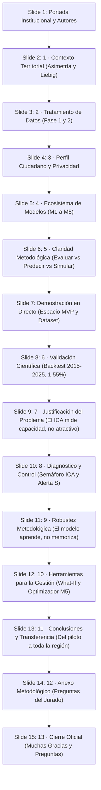

# GUION MAESTRO DE PRESENTACIÓN · II DATATHON LoDCOREMadrid 2026
## Defensa Oficial: Diapositivas Institucionales (15 Slides) + Demostración Web en Vivo
**Fecha de defensa:** 29 de octubre de 2026 · Salón de Grados, Campus de Leganés, UC3M  
**Tiempo oficial de exposición:** 10 minutos (+ turno de preguntas del jurado)  
**Proyecto:** MadridNext · Capacidad de acogida territorial (< 50.000 hab.)  
**Equipo:** Adrián Hernando Muñoz · Juan Torrero de Pablo · Alejandro Cuntin Bariteau  
**Archivo Único de Presentación:** `presentacion_datathon_oficial.pptx`  
**Portal Web en Vivo:** `http://localhost:8088/index.html` | Mapa: `http://localhost:8088/mapa/mapa.html`

---

## 1. Estructura de la Presentación (15 Diapositivas)

---

## 2. Cronograma de Exposición (10 Minutos)

| Tramo | Diapositivas / Soporte | Bloque Temático | Ponente / Mensaje Clave |
|:---:|:---:|---|---|
| **00:00 – 01:00** | Slide 1 – Slide 2 | **Portada y Reto Territorial** | Asimetría metropolitana (80% en el área central) y Principio de Liebig: *un consultorio saturado no se compensa con aire puro*. |
| **01:00 – 02:30** | Slide 3 – Slide 4 | **Ingesta, Calidad y Perfil Ciudadano** | Fases 1 y 2 (datos reales vs. estimados). Paridad Python / Oracle APEX sin almacenar datos personales (RGPD). |
| **02:30 – 04:00** | Slide 5 – Slide 6 | **Modelos M1–M5 y Claridad de Conceptos** | Cinco modelos escribiendo en la misma ficha. Diferencia crucial: Evaluar vs. Predecir vs. Simular. |
| **04:00 – 06:30** | **Slide 7 + DEMO VIVO** | **Demostración Interactiva y Dataset** | Espacio reservado para proyectar el MVP Web (`http://localhost:8088/index.html`) y el Dataset certificado (`municipios_panel_validado.csv`). |
| **06:30 – 07:45** | Slide 8 – Slide 9 | **Validación Científica y Paradoja Demográfica** | Backtesting 2015–2025 (error mediano 1,55%). Por qué los que más crecen tienen menor capacidad ($\rho=0,10$). |
| **07:45 – 09:00** | Slide 10 – Slide 12 | **Diagnóstico, Semáforo ICA y Herramientas** | Semáforo ICA, Alerta dura S. Auditoría antifraude (73 tests). What-if y Optimizador comarcal (2 M€). |
| **09:00 – 10:00** | Slide 13 – Slide 15 | **Transferencia, Anexo de Respuestas y Cierre** | Escalabilidad a 155 municipios. Respuestas blindadas al jurado. Agradecimiento y turno de preguntas. |

---

## 3. Contenido de las 15 Diapositivas (`presentacion_datathon_oficial.pptx`)

### Slide 1: Portada
* **II DATATHON LODCOREMADRID 2026**
* **MadridNext: Capacidad de acogida territorial**
* **Herramienta de diagnóstico dotacional y optimización presupuestaria para municipios de menos de 50.000 habitantes**
* *«El crecimiento demográfico regional no debe planificarse por intuición ni por mero atractivo inmobiliario. MadridNext ofrece a la Administración y a la ciudadanía una base objetiva para identificar techos dotacionales, prever cuellos de botella y priorizar inversiones públicas.»*
* **Adrián Hernando Muñoz · Juan Torrero de Pablo · Alejandro Cuntin Bariteau**
* **155 municipios, 20 en el piloto**

---

### Slide 2: 1 · Contexto Territorial
* **Asimetría demográfica y no compensación**
* Diagnóstico de partida en los 155 municipios de menos de 50.000 habitantes
* **Concentración Metropolitana (80%):** De la población regional vive en el área metropolitana central: congestión viaria, vivienda cara y tensión en la red asistencial. Los 155 municipios restantes tienen potencial, pero antes hay que medir cuánto aguantan.
* **La Paradoja del Atractivo (Menor precio ≠ mayor capacidad):** Un municipio asequible puede no tener plazas escolares ni médicos para nuevas familias. Atraer población donde no hay holgura dotacional traslada el colapso al entorno rural.
* **Regla de No Compensación (Principio del cuello de botella):** Según la ley del mínimo de Liebig, la falta de sanidad o educación no se compensa con suelo ni zonas verdes. Más de 1.500 hab/médico o aulas al 95%: el índice queda por debajo de 40.

---

### Slide 3: 2 · Tratamiento de Datos
* **Datos trazables: qué es real y qué es estimado**
* Fase 1, ingesta y etiquetado de fuentes. Fase 2, control de calidad.
* **Fase 1 · Ingesta:**
  - **INE:** Padrón continuo y migraciones. Población histórica y saldo neto (datos reales).
  - **CAM:** Datos abiertos de la Comunidad (CKAN). Centros de salud en alta (SERMAS) y centros educativos.
  - **Catastro:** Dirección General del Catastro, 2026. Valor catastral medio (€/m²) y volumen edificado.
  - **CRTM:** Consorcio Regional de Transportes. Zonas tarifarias e isócronas medias a Madrid.
  - *Regla de honestidad:* Cada variable lleva su etiqueta REAL o ESTIMADO. Control activo de overfitting desde la ingesta.
* **Fase 2 · Control de Calidad:**
  - **92** columnas del panel verificadas.
  - **0** valores ausentes en las variables de modelado.
  - **20** códigos INE únicos, sin repetidos (piloto metodológico con 92 variables y modelos M1-M5).
  - **73** pruebas unitarias y de integración (100% pasando).
  - **Ampliación Regional en Git:** Cobertura de **155 municipios < 50.000 hab.** (997.059 habitantes, 0 nulos) y **179 municipios de la CAM** con datos 100% oficiales mediante pipeline automatizado (`pipeline_179.py`).
  - `data/validated/municipios_panel_validado.csv` y `panel_menores_50k_real.csv`.

---

### Slide 4: 3 · Perfil Ciudadano y Privacidad
* **Perfil ciudadano y privacidad por diseño**
* Python y Oracle 23ai Cloud como caminos paralelos, con garantía de privacidad (RGPD)
* **Lo que introduce el ciudadano:**
  - Presupuesto de vivienda: Total en euros o máximo por m².
  - Ingresos netos del hogar: Esfuerzo sostenible por debajo del 30%.
  - Tiempo máximo de conexión: Minutos al trabajo o a Madrid.
  - Modo de transporte: Público (CRTM) o vehículo privado.
  - Composición familiar: Hijos y edades: ajusta las plazas escolares.
  - Régimen de tenencia: Compra o alquiler.
  - *Un módulo (`config/perfiles.py`) convierte las respuestas en pesos que suman 1,0 y reordena los municipios sin tocar el ICA objetivo.*
* **Dos caminos paralelos:**
  - Python: Lee el CSV validado.
  - Oracle APEX 23ai Cloud: Desplegado en Autonomous Database (Región Madrid `eu-madrid-1`, autenticación mTLS con Oracle Client Wallet, Workspace `DATATHON`).
  - *Los tests comprueban que ambos producen los mismos pesos y rankings con paridad mTLS y determinismo exacto.*
* **Privacidad estricta y seguridad Cloud:**
  - Conexión cifrada de extremo a extremo mediante Oracle Client Wallet (`cwallet.sso` / `ewallet.p12`). Oracle no guarda ningún dato personal en disco: solo reglas de ponderación en `WKSP_DATATHON` (cada hijo suma 0,05 a educación). Los datos del ciudadano son parámetros volátiles de sesión y nunca se escriben en disco (cumplimiento RGPD).
---

### Slide 5: 4 · Ecosistema de Modelos
* **Cinco modelos, una ficha municipal**
* *«M1 dice si es asequible, M2 si tiene servicios, M3 si va a crecer, M4 cuánta gente cabe y M5 cuál te conviene»*
* **M1 · Asequibilidad y precio (AVM):** ¿Puedo permitirme vivir aquí? Precio predicho (€/m²), esfuerzo familiar (% de la renta) y brecha de mercado.
* **M2 · Dotación e infraestructuras:** ¿Qué tal servicios y conexión? Cuatro subíndices de 0 a 100: sanidad, educación, conectividad y calidad residencial.
* **M3 · Demografía y series temporales:** ¿Va a crecer o a vaciarse? Proyección a 5 y 10 años (2030 y 2035) y año estimado de saturación.
* **M4 · Capacidad neta de carga (ICA):** ¿Cuánta gente cabe y qué se rompe? Habitantes adicionales sostenibles e identificación del factor limitante.
* **M5 · Recomendador y optimizador:** ¿Cuál encaja conmigo? Ranking adaptado al perfil ciudadano y optimización de la inversión pública.

---

### Slide 6: 5 · Claridad Metodológica
* **Evaluar, predecir y simular no es lo mismo**
* Evaluar el presente, predecir el futuro y simular escenarios
* **Evaluar:** *¿Qué municipio encaja con lo que pido?*  
  - *Necesita:* Ningún dato del futuro: lo observado ya existe hoy.  
  - *Función:* Reordenar municipios según preferencias declaradas.  
  - *Implementación:* Ranking adaptativo por perfiles (C2 / M5).
* **Predecir:** *¿Qué pasará en este municipio en 2030?*  
  - *Necesita:* Estimar una incógnita futura con series temporales.  
  - *Función:* Anticipar población y año de saturación.  
  - *Implementación:* Modelo M3 (población 2030/2035 y año de colapso).
* **Simular:** *¿Qué pasa si invierto X o llegan N personas?*  
  - *Necesita:* No predice: recalcula con reglas normativas ante supuestos (what-if).  
  - *Función:* Medir impacto presupuestario y cuellos de botella.  
  - *Implementación:* Simulador what-if y optimizador Simplex.

---

### Slide 7: Demostración en Directo · MVP y Dataset
* **Plataforma interactiva (MVP) y panel de datos**
* Espacio reservado para la demostración del prototipo funcional y la estructura del panel de datos
* **Tarjeta Izquierda · MVP Web (`http://localhost:8088/index.html`):**
  - Espacio para captura o proyección en vivo del portal interactivo.
  - *Hero interactivo* con 4 KPIs comarcales (+108.400 hab., 12,4 M€ inversión necesaria).
  - *Recomendador ciudadano:* Simulación de perfiles y pesos sin almacenar datos personales.
  - *Mapa comarcal:* Semáforo dotacional y filtro de cuellos de botella.
* **Tarjeta Derecha · Dataset Certificado (`municipios_panel_validado.csv` · `panel_menores_50k_real.csv`):**
  - Espacio para captura o muestra tabular del panel de datos.
  - *20 municipios piloto:* 92 variables completas, 0 nulos, modelos M1-M5 y ranking.
  - *Extensión regional Git:* Capa real de **155 municipios < 50.000 hab. (997.059 habitantes, 0 nulos)** y **179 municipios región completa** ingestados con fuentes oficiales (`pipeline_179.py`).
  - *Garantía anti-overfitting:* 73 tests continuos en verde (fugas L1 a L7) y validación espacial GroupKFold por comarca.

---

### Slide 8: 6 · Validación Científica
* **Validación con Backtesting histórico (2015–2025)**
* Backtest temporal ciego: medimos el error proyectando 2020–2025 frente al padrón oficial del INE
* **Metodología en 5 pasos:**
  1. Población real de 2015 y 2020 (INE)
  2. Tasa anual geométrica de crecimiento
  3. Proyección a 2025 sin ver el dato real (Backtest ciego)
  4. Contraste con el padrón oficial de 2025 y cálculo del acierto
  5. Error en porcentaje y en habitantes
* **Métricas centrales:**
  - **1,55%** error mediano de nuestra proyección a 5 años (frente a 7,02% naive).
  - **7,02%** error mediano si se asume que nada cambia.
* **Error de la proyección 2020 → 2025 (%):**
  - Gráfico nativo horizontal de barras con los 7 municipios (Robledo 0,06%, Manzanares 0,39%, Buitrago 1,17%, Meco 1,86%, Chinchón 7,07%, Villa del Prado 10,66%, Montejo 12,31%).
  - *Backtest riguroso: la mitad de los municipios tiene un error inferior al 1,55% a 5 años. En 5.000 hab., el desvío mediano ronda las 78 personas.*

---

### Slide 9: 7 · Justificación del Problema
* **El ICA mide capacidad, no atractivo**
* Esa paradoja justifica la herramienta: crece más quien menos capacidad tiene
* **El límite, dicho con honestidad:**
  - **$\rho = 0,10$:** Correlación entre el ICA y el crecimiento espontáneo: no significativa.
  - El ICA mide dónde hay infraestructura para crecer sin colapsar servicios. La gente no se muda adonde sobran plazas escolares, sino adonde hay alquiler barato o inercia urbana.
* **Los que más crecen, menos capacidad tienen:**
  - **Villa del Prado (+16,2% 2020 a 2025):** ICA 36,9: capacidad baja. Centro de salud y consultorios sobrecargados.
  - **Navalcarnero (+11,2% / 31.979 habitantes):** ICA 24,5: alerta roja, con 1.667 hab/médico y aulas al 95,2%.
  - *Sin intervención, la inercia seguirá llenando municipios ya saturados. MadridNext reorienta ese flujo hacia donde hay capacidad real.*

---

### Slide 10: 8 · Diagnóstico y Control
* **El semáforo ICA y la alerta no compensatoria**
* Umbrales de capacidad e interrupción automática del encaje
* **El Semáforo:**
  - **ALTA (≥ 60):** Mucho margen de acogida. Absorbe población de inmediato sin comprometer colegios ni consultorios. Ej.: Robledo 66,7 y Buitrago 62,5.
  - **MEDIA (40–59):** Margen justo, condicionado. Admite nuevos vecinos si se acompaña de inversiones puntuales en refuerzo de servicios.
  - **BAJA (< 40):** Sin margen: saturación. Servicios esenciales en situación crítica: más vecinos provocan el colapso dotacional.
* **Alerta S · No Compensatoria:**
  - Se activa con más de 1.500 hab/médico o una ocupación escolar superior al 95%.
  - El ICA total se trunca por debajo de 40 y el encaje máximo para cualquier ciudadano queda en 39, aunque la vivienda sea barata o sobren zonas verdes.
  - *Cercedilla:* Puntuación teórica de 34,61, clasificada con alerta S: la red asistencial no admite más presión.

---

### Slide 11: 9 · Robustez Metodológica
* **Control de Overfitting: el modelo aprende, no memoriza**
* Prevención activa de sobreajuste (overfitting), blindaje contra fugas L1-L7 y validación espacial
* **Tres formas de hacer trampa / sobreajuste:**
  - *Mirar al futuro:* Usar la población proyectada a 2031 para predecir 2025 infla las métricas y deja el modelo inservible en producción.
  - *Mezclar vecinos:* Repartir al azar municipios contiguos entre entrenamiento y prueba filtra información geográfica.
  - *Overfitting / Memorizar:* Con N = 20 evitamos redes neuronales complejas o deep learning que memorizarían filas. Usamos árboles regularizados, Ridge y exportación ONNX.
* **Cómo lo comprobamos:**
  - *Comparativa adversarial:* Versiones con y sin fuga deliberada para confirmar que el R² honesto generaliza sin sobreajuste.
  - *Validación espacial GroupKFold:* Los municipios de una misma comarca van juntos a entrenamiento o a prueba.
  - *Control point-in-time:* Ningún dato de entrada es posterior a la fecha de decisión del MVP.
  - *73 tests continuos en verde:* Auditan las 7 fugas de overfitting (L1 a L7) con pytest.

---

### Slide 12: 10 · Herramientas para la Gestión
* **Simulador what-if y optimizador presupuestario**
* Instrumentos para decidir y repartir presupuesto
* **Pantalla 1 · Simulador What-If:**
  - *«¿Si entran 2.000 personas en este pueblo, qué pasa?»*
  - Recalcula al instante todos los indicadores de presión dotacional.
  - Indica qué servicio entra antes en crisis, cuántas plazas o médicos faltan y cuánto cuesta reforzarlo.
  - Permite evaluar planes urbanísticos antes de aprobar licencias residenciales.
* **Pantalla 2 · Optimizador M5 (Simplex):**
  - *«Tengo 2.000.000 €, ¿dónde los reparto en esta comarca?»*
  - Navalcarnero queda en 0 €: su restricción es la vivienda, no las dotaciones.
  - **1.650.000 € invertidos  |  +1.336 personas acogibles  |  350.000 € ahorrados**

---

### Slide 13: 11 · Conclusiones y Transferencia
* **Del piloto de 20 municipios a toda la región**
* 1. **Resolución empírica y Backtest:** Sustituimos la especulación por un marco cuantitativo verificado con backtesting histórico (1,55% de error mediano) evitando cualquier overfitting.
* 2. **Doble utilidad:** Sirve a las familias que planifican su traslado y a los gestores públicos que reparten recursos con rigor.
* 3. **Oracle 23ai Cloud, Wallet mTLS y Agente IA con MCP (¡Desplegado!):** Desplegado en producción en Oracle Autonomous Database 23ai (Región Madrid `eu-madrid-1`) con autenticación mTLS por Oracle Client Wallet (`cwallet.sso` / `ewallet.p12`), Workspace APEX `DATATHON` y conector estándar MCP (`apex-mcp`) para interacción con agentes de IA. Capa real de **155 municipios < 50k hab. (997.059 hab., 0 nulos)** y 179 municipios de la CAM ya ingestada.
* *«No venimos a decir que nuestro índice predice el futuro: venimos a demostrar cuánto acierta, para qué sirve y cómo optimiza cada euro público invertido en la Comunidad de Madrid.»*

---

### Slide 14: 12 · Anexo Metodológico
* **Anexo: preguntas que puede hacer el jurado**
* Respuestas técnicas a las preguntas más probables:
  - *¿Cómo sé que el índice sirve?* $\rightarrow$ Mide capacidad de carga, no atractivo residencial. Contrastado con el crecimiento real, los pueblos que más crecen son los que ya están saturados, lo que justifica intervenir.
  - *¿Son fiables las proyecciones demográficas?* $\rightarrow$ Error mediano del 1,55% a 5 años en ventanas históricas (INE 2015-2025), frente al 7,02% de suponer que nada cambia.
  - *¿Por qué no usáis deep learning / Cómo evitáis el overfitting?* $\rightarrow$ Con 20 municipios, el deep learning causaría un severo overfitting. Empleamos modelos regularizados, validación GroupKFold por comarca y árboles exportados a ONNX con tolerancia < 1e-6.
  - *¿Cómo funciona la Wallet de Oracle y qué agentes IA soporta?* $\rightarrow$ Conexión cifrada mTLS mediante Oracle Client Wallet (`cwallet.sso`, `ewallet.p12`, válidos hasta 2031) a Oracle Autonomous 23ai en Madrid (`eu-madrid-1`, DSN `n590x9g2v58k2mzg_tp`). Aloja el esquema `WKSP_DATATHON` y expone un servidor estándar MCP (`apex-mcp` en `opencode.json`) para que agentes autónomos de IA consulten los 155 municipios en lenguaje natural.

---

### Slide 15: 13 · Cierre Oficial
* **II DATATHON LODCOREMADRID 2026**
* **Muchas gracias**
* **¿Preguntas?**
* **MadridNext: capacidad de acogida territorial**
* **Adrián Hernando Muñoz · Juan Torrero de Pablo · Alejandro Cuntin Bariteau**
* **Universidad Carlos III de Madrid · Comunidad de Madrid**
